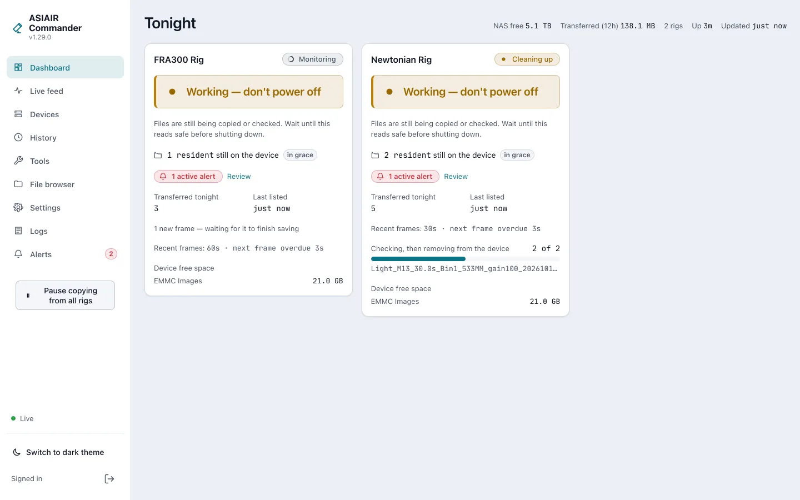
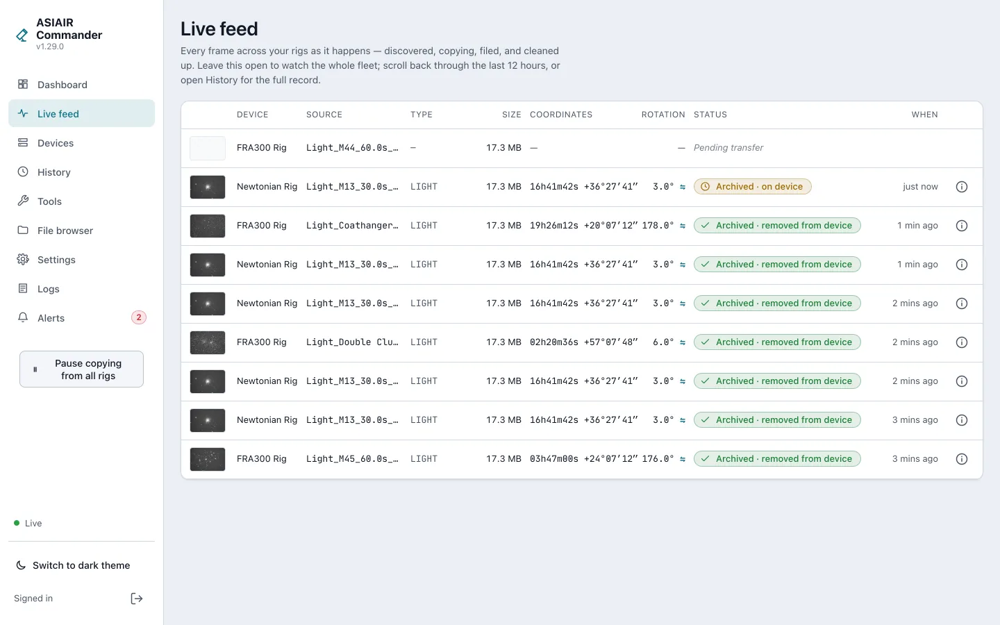
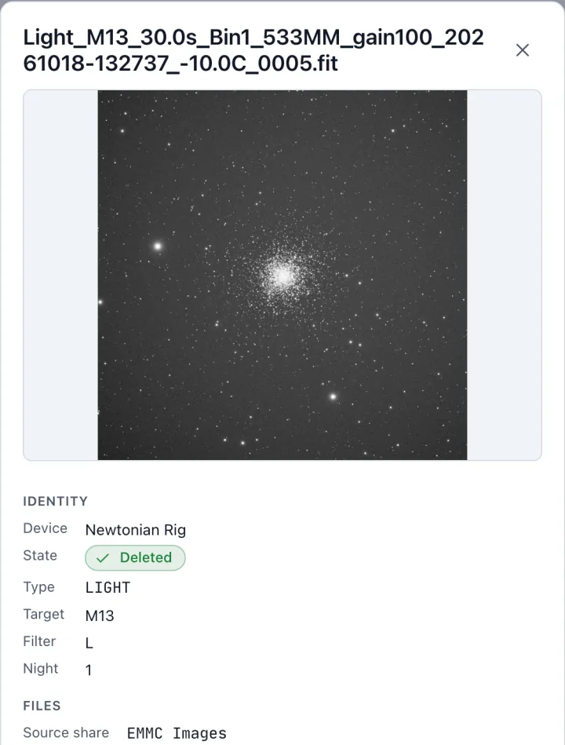
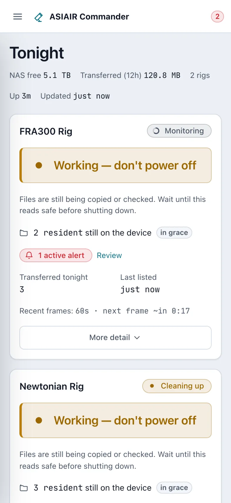

# ASIAIR Commander

ASIAIR Commander moves the frames a ZWO ASIAIR captures onto your NAS while the night is still
running. It watches each rig's storage over SMB1, pulls every finished frame, proves the copy,
files it into a folder layout built from the frame's own FITS header (target, frame type,
filter, exposure, night), and deletes the original from the device only once the copy has been
verified. By morning the night is on the NAS, sorted, and the ASIAIR has room for the next one.

It is a single Go service with a web UI for setup, monitoring and history, and runs as a Windows
service or a container on any always-on machine on the rigs' network. Rigs at another site can
be reached through a small remote that runs there.

ASIAIR Commander is an unofficial, independent project. It is not affiliated with, endorsed by
or supported by ZWO.

## Screenshots

<picture><source media="(prefers-color-scheme: dark)" srcset="docs/screenshots/dashboard-dark.webp"></picture>

*Tonight's dashboard: each rig's card says whether it is safe to power off, what it is copying
and what is left on the device.*

<picture><source media="(prefers-color-scheme: dark)" srcset="docs/screenshots/feed-dark.webp"></picture>

*The live feed: every frame as it is discovered, copied, filed and cleaned up, with a thumbnail
and the coordinates and rotation of Commander's own plate solve.*

<p>
<picture><source media="(prefers-color-scheme: dark)" srcset="docs/screenshots/frame-detail-dark.webp"></picture>
<picture><source media="(prefers-color-scheme: dark)" srcset="docs/screenshots/dashboard-mobile-dark.webp"></picture>
</p>

*Left, a frame's detail with its preview; right, the dashboard on a phone.*

Commander has a light and a dark theme, and the screenshots follow your GitHub theme.
The screenshots come from the demo build, whose rigs and frames are synthetic. The star fields
are rendered from the Gaia DR3 catalogue (ESA/Gaia/DPAC,
[CC BY-NC 3.0 IGO](https://www.cosmos.esa.int/web/gaia-users/license));
[docs/screenshots](docs/screenshots/README.md) says how they are made.

## Safety model

An ASIAIR cannot checksum a file for you, so a copy that only checks itself proves nothing.
Before an original is deleted, Commander compares three things: the hash streamed during the
pull, a read-back of the staged copy taken before it is filed, and a fresh hash of the device
original taken by the delete pass, which must match the recorded hash while a re-hash of the
NAS copy matches too. If deletion is enabled, that verification always runs; there is no switch
to turn it off.

Deletes also wait out a per-rig grace period after the copy is proven, happen only after
Commander has confirmed that the device answering is the rig's own, and never run on a rig set
to keep its originals. A frame whose copy cannot be proven is held and raises an alert rather
than being deleted. *Safe to power off* is reported only when a complete listing of the device
shows nothing left to pull.

The reasoning behind each of these is in
[`docs/design/2026-10-17-overview.md`](docs/design/2026-10-17-overview.md) §4 and
[`docs/design/2026-10-17-delete-safety.md`](docs/design/2026-10-17-delete-safety.md).

## Install

### Docker

```sh
docker run -d --name asiair-commander \
  --network host \
  --restart unless-stopped \
  -v asiair-data:/data \
  -v /mnt/nas/astro:/captures \
  ghcr.io/macourteau/asiair-commander:latest
```

Browse to `http://<host>:8686` and paste the one-time setup token from `docker logs
asiair-commander` into the wizard. Host networking is needed for rig discovery, which uses a
UDP broadcast that Docker's bridge network cannot carry. Images are published for `linux/amd64`
and `linux/arm64`.

[DOCKER_README.md](DOCKER_README.md) is the full guide: compose and Kubernetes examples, ports,
volumes, permissions, networking, health checks and remote sites.

### Windows

Download `asiair-commander-setup-<version>.exe` from the
[latest release](https://github.com/macourteau/asiair-commander/releases/latest) and run it. The
installer registers and starts the `ASIAIRCommander` service, adds a firewall rule for it, and
opens the web UI to finish setup. Configuration, state and logs live in
`%ProgramData%\ASIAIRCommander` and are kept when the program is uninstalled.

### Build from source

You need Go (the version in `go.mod`), Node.js 22 with npm, and `make`.

```sh
make build            # builds the web UI, then bin/asiair-commander
bin/asiair-commander -data-dir ./data
make help             # every target, with a one-line description
```

`make installer` builds the Windows installer (it needs `makensis`), and `make notices`
generates the licence and third-party notices for a distribution (after `make spa`). A bare
`go build ./cmd/asiair-commander` without `make spa` works but serves a placeholder page instead
of the web UI.

## Documentation

- [docs/design/](docs/design/README.md): how Commander works and why, starting with the
  [overview](docs/design/2026-10-17-overview.md).
- [docs/metrics.md](docs/metrics.md): the Prometheus metrics served at `/metrics`.
- [DOCKER_README.md](DOCKER_README.md): running the container image, and remote sites.

## Development

Prerequisites are those of a source build, plus Docker for the integration tests.

```sh
make check            # the same checks as CI's required build-test job
make integration      # real-SMB and real-tunnel tests against a Samba container (needs Docker)
make dev              # how to run the backend and the Vite dev server side by side
make screenshots      # regenerate the README screenshots from a live demo run
```

`make check` compares the recorded protocol transcripts against `CHECK_BASE` (default
`origin/main`); set it when your branch tracks another remote.

Commit messages and pull request titles follow
[Conventional Commits](https://www.conventionalcommits.org): the release version and notes are
derived from them. UI changes are checked with the screenshot harness in
`scripts/screenshots.mjs` and the seeders under `tools/`, which stage realistic data without any
hardware; [CLAUDE.md](CLAUDE.md) describes the workflow and the repository's conventions.

Report bugs through the issue form, and security problems privately as described in
[SECURITY.md](SECURITY.md). Leave personal data out of both.

## Licence

ASIAIR Commander is released under the [MIT licence](LICENSE).

Every distribution carries its third-party notices: the `THIRD_PARTY_NOTICES` folder in the
Windows install directory, `/usr/share/doc/asiair-commander/` in the container image, and a
`THIRD_PARTY_NOTICES-windows-amd64.zip` asset on each release. The web UI's bundled packages are
also listed at `/third-party-notices.txt` on a running server. Both distributions bundle the
command-line plate solver of [ASTAP](https://sourceforge.net/projects/astap-program/), unmodified, under the
Mozilla Public License 2.0; see [third_party/notices/astap_cli.txt](third_party/notices/astap_cli.txt).
