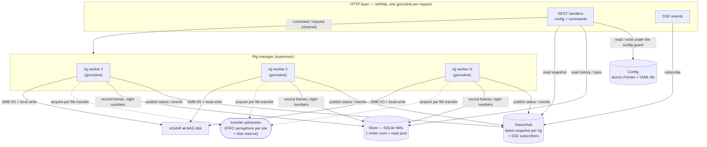

# Architecture

**Scope.** How ASIAIR Commander is built: the runtime shape, the threading model that keeps
the UI responsive whatever a device does (the never-block guarantee), and the seams every
subsystem tests against; persistence in two deliberately separate stores; the web layer —
authentication, token-based first-run setup, the Host, Origin and CSRF checks, the paired
HTTP and HTTPS ports, the config API, server-sent events and diagnostics; the UI surfaces,
the alert catalogue, session logs, the failure model, the testing strategy, dependencies
and tuned parameters; and metrics, application logging, packaging and licensing. The
product contract and glossary are in [overview](2026-10-17-overview.md). The per-frame
mechanism is in [frame-lifecycle](2026-10-17-frame-lifecycle.md), and classification and
filing are in [routing-and-filing](2026-10-17-routing-and-filing.md); §5 and §6 here only
point to them. This document hosts the first-run setup invariants 1–15 (§8.2), the
dual-port invariants 1–6 (§8.5), the validation-surfacing series C1–C4 (§8.8), the
Prometheus hazards P1–P15 (§17.6) and the metrics invariants I1–I8 (§17.8).

## 1. What Commander is

A single Go binary that watches every configured ASIAIR over SMB1, pulls each captured
frame shortly after it is written, proves the copy byte for byte, files it into a
configurable folder layout derived from the frame's own FITS header and, once the copy is
proven, deletes the original so the device never fills. It is configured and observed
entirely through an embedded web UI reachable from any browser on the LAN.

There is no server, no cloud and no second copy: **the pull is the write**. That makes
read-integrity verification the load-bearing safety mechanism
([overview §4](2026-10-17-overview.md); [frame-lifecycle §6, §9](2026-10-17-frame-lifecycle.md)),
and it is why none of the machinery a client/server sync needs exists here — no spool, no
push pipeline, no confirmations or possession checks, no enrollment, no config sync. Rigs at
another location are reached through an encrypted tunnel to a small remote process
([remote-sites](2026-10-17-remote-sites.md)); the architecture below is the same for them.

## 2. Runtime shape

| Concern | Choice | Why |
|---|---|---|
| Process | One Go binary (`CGO_ENABLED=0`). On Windows it runs as a service through `kardianos/service`; elsewhere it runs in a distroless container (§19.2). Both deployments are first-class. | Always on, headless, survives reboots; one artifact to build, test and ship. |
| Verbs | `run` (default), `install` / `uninstall` (Windows service), `healthcheck`, `version`, `remote` (the remote-site role, [remote-sites §4](2026-10-17-remote-sites.md)) | The installer and the container healthcheck drive the binary itself instead of needing a plugin or a shell. |
| Web UI | React SPA built with Vite and embedded through `go:embed` | The UI is the only window into the running system; embedding keeps deployment to one file. |
| HTTP | stdlib `net/http`: the embedded SPA, a JSON REST API, and SSE streams | No framework needed; SSE needs nothing beyond `http.Flusher`. |
| Config | One human-readable YAML file, app-owned, written atomically (§7.2) | Small, precious, and reconstructible by nobody; survives a corrupt state database. |
| State | SQLite through `modernc.org/sqlite` (pure Go), WAL (§7.7) | Bulky, reconstructible operational history; pure Go keeps cross-compilation trivial. |
| SMB | `github.com/macourteau/smb1client`, a public Go module consumed through `go.mod` like any other dependency | A pure-Go SMB1 client that speaks to the ASIAIR; the transport behaviours it must honour are in [asiair-hardware-notes §9](2026-10-17-asiair-hardware-notes.md). |
| FITS | `github.com/astrogo/fitsio` (BSD) | Pure Go, no cgo. Code from PCL-licensed astronomy projects is never lifted into this repository. |
| Remote tunnel | `github.com/tailscale/tailcat` | [remote-sites §2](2026-10-17-remote-sites.md). |

In development the Vite dev server proxies `/api` and `/events` to the Go backend; in
production the binary serves the embedded bundle. The build therefore needs both Go and
Node, the one accepted cost of the SPA choice (§8.10).

The data directory is `%ProgramData%\ASIAIRCommander` on Windows and whatever `-data-dir`
names elsewhere (`/data` in the container; an XDG path under `$HOME` for a development
run). It holds `config.yaml`, `state.db`, `logs/`, the self-signed TLS pair under `tls/`,
the preview cache, the plate-solver catalogs, the upload staging area and, while setup is
pending, the setup-token file.

Startup runs in a fixed order, each step depending on the ones before it:

1. load (and if needed forward-migrate) the config (§7.3); a config written by a newer
   binary stops startup;
2. open the state database and run its migrations (§7.8);
3. build the metrics registry, the status hub, the notifier and the local filesystem;
4. build the site registry, the device factory and the discovery scanner; start the remote
   supervisor, then run one synchronous scan_air round so a worker's first cycle can
   already resolve its device (§3.9);
5. build the transfer admission (§3.4), the previewer and the plate-solve provisioner when
   enabled;
6. start the rig manager, which recovers open intents and rebuilds the night counters
   before any worker exists (§7.11);
7. start the solve worker, the astrometry and exposure-identity backfills and the
   background discovery timer; register the scrape-time metrics collector (§17.2);
8. build the device file browser service and the web server, bind the ports (§8.5, §8.6),
   and serve until the context is cancelled.

## 3. Threading model: the never-block guarantee

### 3.1 The rule

**The HTTP layer never performs SMB I/O, and rig workers never touch the HTTP layer.**
They meet only at two decoupling points, the `Store` and the `StatusHub`, both fast and
in memory on the dashboard's read path. Everything slow lives inside rig workers. This is
the mechanism behind [overview §7.4](2026-10-17-overview.md) ("the UI never waits on a
device").



The guarantee is about the live dashboard, which reads the in-memory hub. History and
statistics endpoints read SQLite and can in principle wait on `busy_timeout` (§7.9); they
are operator-initiated, tolerate a brief pause, and stay off the SSE path.

### 3.2 One goroutine per rig

Each managed rig has exactly one worker goroutine. The harvester's seriality per rig — one session
and one file at a time, never a parallel read of one device ([overview §6](2026-10-17-overview.md))
— is therefore structural: the worker cannot open a second session against its own rig, and there is
no in-flight bookkeeping to get wrong. Parallelism across rigs is free. The device itself tolerates
several concurrent sessions ([asiair-hardware-notes §9.1](2026-10-17-asiair-hardware-notes.md)); the
file browser, which opens its own sessions beside the worker's, is the deliberate exception (§3.3,
[device-file-browser](2026-10-17-device-file-browser.md)).

### 3.3 Scoped exceptions on the request goroutine

Two features perform device I/O on the request goroutine, and nothing else may:

- **`Scanner.DeviceShares`**, called by the adopt dialog's handler to list a discovered
  device's shares before it becomes a rig.
- **The device file browser** (`internal/devfiles`,
  [device-file-browser](2026-10-17-device-file-browser.md)). Its listing, download, copy,
  delete, rename and upload requests open their own SMB session to a managed rig rather
  than routing through its worker, so a slow or hung device holds that request's goroutine
  and nothing else.

What keeps the guarantee is that neither holds a lock shared with a worker, the hub or the
snapshot read path; from the hub the file browser only reads the endpoint the rig's worker
published. `TestDevfilesListingNeverBlocksReadPath` (`test/neverblock`) proves it: while a
listing is parked inside a device that has stopped answering, `/api/alerts` and
`/api/config` keep answering within the never-block bound. **Any further exception needs
the same two things: no shared lock, and a `test/neverblock` case.**

### 3.4 The transfer semaphore

Every file transfer passes through one `Admission` (`internal/manager`), acquired **per
file** with the worker's context (so a shutdown or pause aborts a queued acquire) and
released at the frame's terminal outcome. Admission has two parts:

1. **A concurrency slot chosen by site.** Rigs on the local site share one FIFO
   `golang.org/x/sync/semaphore.Weighted` sized by `max_concurrent_transfers` (default
   3). Each remote site gets a one-slot semaphore of its own outside that cap, so a narrow
   remote link carries one transfer at a time and never holds a LAN rig's slot while it
   trickles ([remote-sites §9](2026-10-17-remote-sites.md)).
2. **The disk-reserve check with in-flight accounting** (§7.6), applied to every site
   after the slot is granted.

What actually contends is the access point's airtime, and transfers contend where idle
sessions do not, so the cap is on simultaneous transfers. Because the slot is per file and
FIFO, a rig with a huge first-cycle backlog cannot starve the others: slots rotate fairly.
`x/sync/semaphore` is chosen over a buffered channel for that FIFO waiter order; a
channel's wakeup order is unspecified.

This is deliberately **not a worker pool**. A pool that returns slots at cycle granularity
lets a few large backlogs occupy every slot for tens of minutes (§13).

Dusk calibration is the opposite shape from the light steady state: a hundred bias frames
and a run of flats per rig appear at once, on every rig, when an internal-storage unit is
most capacity-stressed. Throughput of that burst does not matter; the semaphore serializes
it and the per-file grain keeps one rig's burst from starving another. Device capacity
during the burst is the real concern, and the levers are stated honestly: Commander cannot
throttle the ASIAIR or delete a frame before its grace elapses, and `disk_reserve_bytes`
protects the NAS volume, not the device. What it can do is drain a capacity rig on a short
grace (§16) and alert early on the device's own free space (§10). If an internal-storage rig
still fills, that is the ASIAIR's own behaviour, which no downstream tool can prevent: the
design's job is to drain as fast as safety permits and warn, not to pretend a NAS-side gate
protects the device. There is no cross-rig "drain priority" scheduler: it would need a global
coordinator that fights the FIFO semaphore, and short grace is the lever that matters.

### 3.5 The worker select loop

```
Run:
  apply any commands already queued (a pause restored across a restart wins)
  run an initial cycle promptly
  loop select:
    ctx.Done            → return                      // shutdown / rig removed
    cmds                → apply(command)              // reload, pause, resume, run, stop run,
                                                      //   reclassify, reset identity
    dismiss / restore / link / retarget / refile requests → service, reply   (§3.6)
    discovery wake      → re-probe if offline         (§3.9)
    remote wake         → cycle at once unless paused (remote-sites §8)
    ticker              → runCycle unless suspended   // pull, verify, file, delete
```

- **Cycles never overlap.** The ticker is reset after a cycle returns (fixed delay, not
  fixed rate), so a long first sync of a full device delays the next cycle instead of
  stacking sessions. The interval is floored so a hand-edited non-positive interval can
  never panic the ticker.
- **Commands take effect within one file's time.** `drainCommands` runs between files in
  the pull, delete, restore and library-scan loops, so a pause or reload signalled
  mid-cycle never waits for the cycle to end.
- **The delete pass is sliced.** A slice that still has eligible frames when its deadline
  (anchored on the cycle's listing) passes yields; the cycle reschedules after one second
  instead of a full poll, and the next slice resumes from a round-robin cursor
  ([frame-lifecycle §12](2026-10-17-frame-lifecycle.md)).
- **A malformed frame cannot take the service down.** Each cycle and each per-file step
  runs under `recover()`; a panic becomes a `failed` row and an alert
  ([frame-lifecycle §10](2026-10-17-frame-lifecycle.md)).

### 3.6 Frame mutations run on the worker goroutine

Every mutation of a rig's frame rows and of the files they describe runs on that rig's
worker goroutine. There is no lock around them: the single goroutine *is* the
serialization. A mutation performed from a request goroutine could race the worker's own
passes — a concurrent re-pull raising a spurious "frame lost" alert after a purge, or a
purge deleting a copy the worker just re-filed at the same path.

The control channel (`cmds`) is a fire-and-forget enum with no payload and no reply, so
operator actions that name a frame or return a per-frame result use dedicated
**request/reply channels**. The handler sends a request carrying a reply channel and waits
on it under a context with a timeout; every reply channel is buffered (capacity 1), so a
caller that gives up never blocks the worker's send. The timeout bounds the caller, not a
syscall already in flight on the worker.

| Operation | Carried by | Serviced in | Why there |
|---|---|---|---|
| Dismiss an unclassified frame ([frame-lifecycle §13](2026-10-17-frame-lifecycle.md)) | `dismissReqs` | `Run` and `drainCommands` | Touches only the NAS copy and the database; a discard issued during a long pull is handled within one file's time. |
| Restore, cancel restore, acknowledge, acknowledge a group ([library-reconciliation §4.4, §10.8](2026-10-17-library-reconciliation.md)) | `restoreReqs` | `Run` and `drainCommands` | Row-flag writes that must not race the delete pass; cheap enough to service mid-cycle. |
| Link a library root ([library-reconciliation §8](2026-10-17-library-reconciliation.md)) | `linkReqs` | `Run` only | Writes the marker and clears missing marks on the NAS; `drainCommands` runs between device operations, so NAS work is not drained there. |
| Retarget a frame ([routing-and-filing §9.6](2026-10-17-routing-and-filing.md)) | `retargetReqs` | `Run` only | It takes an admission slot; servicing it inside the delete pass, which already holds one, would deadlock a single-slot configuration. |
| Re-file a group ([routing-and-filing §8.8](2026-10-17-routing-and-filing.md)) | `refileReqs` | `Run` only | It takes no slot; one request carries a whole group so a large migration does not wait one poll per frame. |
| Re-classify the unclassified area ([routing-and-filing §2.3](2026-10-17-routing-and-filing.md)) | `cmds` (`Reclassify`) | the cycle | A flag the next cycle acts on; it moves files into the tree the same goroutine files into. |

`Run` services these channels whether or not the rig is paused (only the ticker branch
checks pause), so dismiss, restore and acknowledge work while a rig is paused or its
device is offline: they touch the NAS and the database, never the device.

### 3.7 The rig manager

The manager (`internal/manager`) owns the worker set: a map of rig id to a handle holding
the worker and its cancel function. HTTP handlers run one goroutine per request, and a
concurrent read and write of a Go map is a fatal, unrecoverable crash, so handlers never
touch the map: every add, edit, pause, removal and command goes through a manager method
behind a `sync.Mutex`. The call is quick — a guarded map operation plus a channel send or a
context cancel — and the worker reacts on its own schedule.

`Reconcile` diffs the managed set against a config snapshot, starting and stopping workers.
Stopping a worker also forgets its metric series and removes it from the hub snapshot
(§17.4). The manager's one config writer is the host-to-guid binding applier
([device-identity-and-media §3.4](2026-10-17-device-identity-and-media.md)); the lock
order is always the config guard before the manager mutex. A maintenance loop ticks every
30 s: it publishes NAS free space and the rolling transferred-bytes total, applies pending
guid binds, checkpoints the WAL every 5 minutes (§7.9) and runs retention hourly (§7.10).

### 3.8 Config snapshots and apply-on-restart

The live config is an immutable `*model.Config` behind an `atomic.Pointer`. A config write
builds a fresh value under the config guard, saves it, hands it to the manager (which fans
a reload out to every worker's command channel), and swaps the pointer (§8.8). A worker
reads the pointer at each cycle boundary, so it never observes a half-updated config.

A few settings size structures built once at startup and are **apply-on-restart**: a change
is validated and persisted at once, takes effect at the next service start, and the
Settings page says so beside the control.

- `max_concurrent_transfers` sizes the local semaphore. Resizing a semaphore with acquirers
  already blocked on it can strand a waiter that acquired against the old width; carrying
  that complexity for a knob that almost never changes is not worth it.
- `previews_enabled`, `preview_concurrency` and `preview_cache_max_bytes` build the
  previewer ([features §1](2026-10-17-features.md)).
- `plate_solve_enabled` starts the provisioner and solve worker
  ([features §3.8](2026-10-17-features.md)); `plate_solve_radius_deg` is live.

Every other setting is live through the pointer swap.

### 3.9 Discovery runs outside the workers

Discovery is not a worker. The scanner (`internal/discovery`) broadcasts one scan_air UDP
round per scan and merges the replies into a registry keyed by device guid, with a cpuId
secondary index ([device-identity-and-media §2](2026-10-17-device-identity-and-media.md);
the protocol is [asiair-hardware-notes §5](2026-10-17-asiair-hardware-notes.md)). One
round runs synchronously at startup before the manager starts; after that a background
timer rescans every 45 s, and the Scan button triggers a round on demand.

The registry answers the hot-path questions with no network I/O: the discovered list the
UI shows, `Resolve(guid, cpuId)` for a worker's current device address, and the
online/managed flags. Only `ProbeGUID` (identity confirmation) and `DeviceShares` (adopt
time, §3.3) touch the network. A managed device answering a round wakes its worker, so a
rig that was offline re-probes at once instead of waiting out its retry interval; the wake
is a separate channel, not a command, so a device answering every round never postpones
the worker's own schedule. Steady-state presence ("rig came online") is simply a worker's
reachability probe succeeding after failing.

## 4. Seams

Every boundary to the outside world is an interface, so the core logic tests against
fakes. The two that carry the fiddliest correctness, the classifier and the router, are
pure functions with no I/O, exhaustively unit-testable against real header fixtures
(§14.1).

| Seam | Shape | Real implementation | Fake / test |
|---|---|---|---|
| `Device` → `Session` → `Share` (`internal/device`) | probe and open; list shares, mount; `ListDir`, `Stat`, `OpenReader`, `Delete`, exclusive `CreateNew`, `Mkdir`, no-replace `Rename`, `Chtimes`, `Statfs`, `VolumeInfo`, marker read/write | `smb1client` | in-memory `device.Fake`; Samba in Docker for integration (§14.4) |
| `LocalFS` (`internal/localfs`) | `FreeSpace`, cache-bypassing `VerifyRead` / `VerifyReadTee`, `RenameNoReplace`, write probe, extended-length paths, same-volume test | `os` plus `GetDiskFreeSpaceEx`, `FILE_FLAG_NO_BUFFERING`, `MoveFileExW` on Windows; `statfs`, `O_DIRECT`, `renameat2(RENAME_NOREPLACE)` on Linux; `renameatx_np(RENAME_EXCL)` on macOS | `localfs.Fake` over a temp dir |
| `HeaderReader` (`internal/header`) | read the header of the local copy | `astrogo/fitsio` plus a native END-card scan | header fixtures; `fitstest` synthetic frames |
| Classifier (`internal/classify`) | pure `(Header, alias table, sensor map) → Classification` | — | real headers as golden inputs |
| Router (`internal/route`) | pure `(Classification, rig profile, night, options) → destination path` | — | table-driven, adversarial inputs |
| `Store` (`internal/store`) | operational state (§7.7) | SQLite | temp database |
| `Clock` (`internal/clock`) | wall time, monotonic instants, device-time offset in typed domains | wall and monotonic clocks | fixed clock for settle, grace and night tests |
| `StatusHub` (`internal/hub`) | `PublishRig`, `Snapshot`, `Subscribe`, `Emit` | in memory | used directly |
| `Notifier` (`internal/notify`) | `Raise(alert)`, the single alert choke point (§10) | store row, plus SSE event and badge refresh when the row is new | captured in tests |
| Site registry (`internal/netsite`) | routes each dial and probe to the network its endpoint names | local network; tunnel per remote ([remote-sites §3](2026-10-17-remote-sites.md)) | fake sites |

Two free-space calls must not be conflated. `Share.Statfs` reports one device share's own
free space (a per-share figure on the rig card, and the input to the capacity escalation,
§10). `LocalFS.FreeSpace` reports the NAS destination volume, the figure the
`disk_reserve_bytes` check reads (§7.6). Conflating them would leave the NAS unprotected.

`LocalFS.VerifyRead` is the cache-bypassing read-back that verifies the written copy at rest
and re-hashes it at delete time; bypassing the page cache is what makes it a physical-device
read rather than a re-read of RAM ([frame-lifecycle §6](2026-10-17-frame-lifecycle.md)).
`Share.VolumeInfo` is diagnostic only: removable-media identity uses a marker file, not the
volume serial, because that serial is synthetic (H10;
[device-identity-and-media §6](2026-10-17-device-identity-and-media.md)).

## 5. The frame lifecycle

One managed rig, one cycle, all SMB I/O serial within the rig. The steps keep fixed
numbers, each a top-level section of [frame-lifecycle](2026-10-17-frame-lifecycle.md):
**1** reachability probe, **2** connect, **3** list (shares and roots, the junk filter,
sidecars, two shares on a USB-primary rig), **4** decide to pull (the skip predicate,
quiescence, retry backoff), **5** pull (admission, streaming hash, staging temp and
in-flight reserve), **6** verify the copy at rest, **7** classify, **8** route and file
(atomic name claim, deterministic disambiguation, the grace anchor), **9** delete pass (the
three-way integrity check, vanished sources and NAS copies), **10** disconnect, and
per-frame recovery. The same document owns device-side frame revision (§11), delete-pass
slicing (§12), dismissing a stuck unclassified frame (§13), and the "safe to power off"
and "drained" verdicts (§14). Every path that removes a file, and the invariants guarding
each, is enumerated in [delete-safety](2026-10-17-delete-safety.md).

## 6. Classification and routing

A frame is classified by its FITS header, never by its name or folder, and routed through
one editable template per frame class with a specified token rendering; any routing failure
quarantines it in an unclassified area from which it is never deleted. Night numbering,
mosaic panels, path safety, filename uniqueness, re-filing and retargeting live in
[routing-and-filing](2026-10-17-routing-and-filing.md).

## 7. Persistence

### 7.1 Two stores, split on purpose

**Separate the precious and small from the bulky and reconstructible**, so a corrupt state
database can never cost the operator their setup. The config file holds what nobody could
reconstruct (credentials, templates, rig profiles); the state database holds operational
history that the NAS tree and the devices can rebuild (§7.11).

### 7.2 The config file

`config.yaml` in the data directory (§2). The UI writes it; hand-editing is possible but
not the supported path. A save writes a temp file, fsyncs it, renames it over the target,
and keeps a `.bak` of the prior version; secrets are protected as §7.4 describes. A first
run finds no file, starts from `config.Defaults()` (no password, no session secret), and
serves the setup wizard (§8.2).

It holds:

- **Global settings:** the web password's bcrypt hash; the session secret that signs login
  cookies (rotating it invalidates every session); `web_port` (8686; HTTPS on the next
  port, §8.5); `strip_target_spaces`; the four destination roots (light, calibration,
  staging, logs); `exclude_extensions` and `delete_sidecar_extensions` (both `jpg`, `jpeg`;
  the sidecar list must be a subset of the excluded list, so a mistyped `.fit` can never
  delete science frames); `disk_reserve_bytes`; `max_concurrent_transfers`;
  `mosaic_detection` (off); the preview and plate-solve settings; `missing_display_period`;
  `date_format` (the `<DATE>` token's Go layout).
- **Per-rig defaults** under `defaults`, each overridable per rig except where noted: poll
  and retry intervals, `settle_cycles`, `min_file_age`, `grace`, `reconcile_settle`, the
  failed-frame retry backoff, `unreachable_alert_after`.
- **Web settings** under `web`: bcrypt cost, session idle timeout and maximum age, login
  backoff base and cap, the global login cap, `allowed_hosts`, `metrics_expose_lan`.
- **SMB settings** under `smb`: the remove retry budget.
- The `IMAGETYP` **alias table**, the `INSTRUME` → **sensor map**, and the **templates**
  (light, one per calibration type, mosaic).
- **Rig profiles:** a stable `id` (the key, never an address), `name`, the device binding
  (`guid`, `cpuId`; `host` only on a rig not yet migrated to a guid binding,
  [device-identity-and-media §3](2026-10-17-device-identity-and-media.md)), SMB
  credentials, `ota`, `session` (per rig, not global, because a fleet images different
  sessions at once), `sources` (share plus roots, each share optionally
  `disabled`), `managed`, `capacity_constrained`, `pull_logs`, `keep_originals`,
  `sync_clock`, and per-rig overrides.
- **Remotes** and their pairing secrets, when any are configured
  ([remote-sites §5](2026-10-17-remote-sites.md)).
- `updated_at`, the optimistic-concurrency token (§8.8).

The canonical sample, with the shipped defaults (durations are Go strings so the file is
legible; roots ship empty and are chosen in the wizard — container paths shown):

```yaml
schema_version: 4
web_port: 8686                     # HTTPS is served on 8687 (§8.5)
password_hash: "$2a$12$..."        # bcrypt; redacted from GET /api/config
session_secret: "..."              # redacted; DPAPI-wrapped on Windows
strip_target_spaces: true
mosaic_detection: false            # opt-in: recognise <target>_<row>-<col> panes
roots:                             # staging, light and cal must share one volume (§7.5)
  light: /captures/Lights
  cal: /captures/Calibration
  staging: /captures/.staging
  logs: /captures/Logs
exclude_extensions: [jpg, jpeg]
delete_sidecar_extensions: [jpg, jpeg]   # validated as a subset of exclude_extensions
disk_reserve_bytes: 5368709120     # 5 GiB
max_concurrent_transfers: 3        # global, local site only; apply-on-restart (§3.8)
previews_enabled: true             # apply-on-restart
preview_concurrency: 2
preview_cache_max_bytes: 2147483648
plate_solve_enabled: true          # apply-on-restart
plate_solve_radius_deg: 10
defaults:                          # per-rig knobs; a profile may override most of them
  poll_interval: 45s
  retry_interval: 5m
  settle_cycles: 1
  min_file_age: 300s
  grace: 1h                        # > 0 whenever the rig deletes (§16)
  reconcile_settle: 24h
  failed_retry: { base: 2m, factor: 2, max: 1h, max_attempts: 6 }
  unreachable_alert_after: 15m
web:
  bcrypt_cost: 12
  session_idle_timeout: 168h
  session_max_age: 720h
  login_backoff_base: 1s
  login_backoff_cap: 30s
  login_global_cap: 20
  allowed_hosts: [localhost]       # editable in the wizard and in Settings (§8.2)
  metrics_expose_lan: false
smb: { remove_retry_budget: 10 }
date_format: "2006-01-02"
alias_table: { light: LIGHT, dark: DARK, flat: FLAT, bias: BIAS,
               "dark frame": DARK, "bias frame": BIAS }   # keys case-folded at lookup
sensor_map: { "ZWO ASI6200MM Pro": "6200MM", "ZWO ASI2600MM Pro": "2600MM",
              "ZWO ASI294MC Pro": "294MC" }
templates:
  light: "<TARGET>/<OTA>/<SESSION>/NIGHT_<n>"
  cal:
    DARK: "<SENSOR>/DARK/<GAIN>/<BINNING>/<SET-TEMP>/<EXPOSURE>/<DATE>"
    FLAT: "<SENSOR>/FLAT/<OTA>/<GAIN>/<BINNING>/<DATE>"
    BIAS: "<SENSOR>/BIAS/<GAIN>/<BINNING>/<SET-TEMP>/<DATE>"
  mosaic: "<TARGET_BASE>/<OTA>/<SESSION>/<TARGET_BASE>_<PANEL>/NIGHT_<n>"
rigs:
  - id: rig-01                     # stable key, never an address
    name: Main Rig
    guid: "0a1b2c3d"               # scan_air device identity (the binding)
    cpuId: "0011223344556677"      # secondary key, survives a guid change
    user: guest
    password: "..."                # redacted on GET
    ota: FRA300
    session: Summer2026
    sources:
      - { share: "Udisk Images", roots: [Autorun] }
      - { share: "EMMC Images",  roots: [Autorun] }   # a USB-primary rig watches eMMC too (H12)
      - { share: "TF Images",    roots: [Autorun], disabled: true }
    managed: true
    capacity_constrained: true     # drives the "capture may stop" escalation (§10)
    pull_logs: false
    keep_originals: false
    sync_clock: false
    # optional overrides: grace, poll_interval, retry_interval, settle_cycles,
    # min_file_age, reconcile_settle (never max_concurrent_transfers: it is global)
updated_at: 1760000000000000000    # set at each save; the optimistic-concurrency token
```

Share names come from the device, not from a hardcoded list: the adopt dialog enumerates
the device's real storage shares (administrative `$` shares filtered out) and the operator
picks what to watch, so any model's share set works without a code change
([asiair-hardware-notes §3](2026-10-17-asiair-hardware-notes.md)). Config validation warns
when a rig watches a Udisk share but not the eMMC share (H12).

### 7.3 Config schema version and migrations

The file carries a `schema_version`. A binary meeting an older version migrates it forward
in memory on load, first refreshing the `.bak` with the pre-migration bytes (best effort: a
backup that cannot be written never blocks startup, since the on-disk file is untouched
until the next atomic save). A binary meeting a **newer** version **refuses to start**,
symmetric with the state database. A lossy round-trip would silently drop keys the older
binary does not know and then persist the loss over the `.bak`.

Two version tracks share one number line. A config with no remote is stamped with the
current schema version; one holding a remote is stamped one higher, so a binary that
does not know remotes refuses it rather than silently dropping its pairing keys. Load accepts
both and migrates neither; `TestSchemaVersionTracksStayOrdered` keeps the remotes track
above the current one.

Decoding differs by path, deliberately. YAML loading ignores unknown keys, so a file
carrying a key the schema does not define (such as a `tls:` block, §8.5 invariant 6) still
loads, and YAML durations accept a bare number as seconds. The JSON API decodes strictly
(unknown fields rejected, durations must carry a unit) because a form never produces
either and a strict decode gives a precise error (§8.8). Templates and the host allowlist
are normalized at load as well as at save, so a config that is never re-saved still
validates.

### 7.4 Secrets and file permissions

The config holds the session secret (with which anyone could forge a valid cookie and skip
bcrypt entirely), the password hash, per-rig SMB passwords and remote pairing secrets. On
Windows `%ProgramData%` is world-readable by default, so:

- **The file's ACL is replaced** with a protected, inheritance-disabled ACL granting
  LocalSystem, Administrators and the account the process runs as. The same restriction is
  applied to the `.bak` and to the atomic-write temp, and the temp is restricted **before**
  any secret byte is written to it, so a secret never sits in a world-readable file for the
  write window. Every secret-bearing file Commander writes (config, `.bak`, setup token)
  goes through that one writer.
- **The session secret and the remote pairing secrets are wrapped with DPAPI** at machine
  scope, so a bare file read does not yield them and they still decrypt under the service
  account.
- **The service runs as the virtual account `NT SERVICE\ASIAIRCommander`**, not
  LocalSystem: least privilege, no interactive logon. The installer creates the data
  directory with `icacls /inheritance:r` granting only SYSTEM and Administrators, then adds
  the service account (§19.1).

Elsewhere the data directory is created `0700` and secret-bearing files `0600`. Windows
ignores those mode bits, and the installer's ACL covers only the default data directory, so a
custom `-data-dir` on Windows is protected by neither: there the restricted writer is the only
protection a secret-bearing file has, which is why it is used inside the data directory too. In a
container, access to the data volume and to `docker logs` is the operator's existing
responsibility. The TLS private key is written `0600` under `<data-dir>/tls`.

### 7.5 One managed destination volume

Staging, the light tree and the calibration tree live on **one** NAS volume. This makes
every filing rename same-volume and atomic
([frame-lifecycle §8.1](2026-10-17-frame-lifecycle.md)) and free-space reasoning one
number rather than a per-volume model. Config validation **rejects** (an error, not a
warning) a configuration whose staging, light and calibration roots do not resolve to one
volume: a cross-volume rename fails, there is no copy fallback, and filing into the
off-volume tree would silently stall. Splitting the trees across disks is not supported.
The logs root is outside this rule; logs are copied, never renamed into place.

### 7.6 Free space and the disk reserve

Pulls pause while the destination volume's free space, less the bytes already reserved by
transfers in flight, less the projected size of the next pull, would fall below
`disk_reserve_bytes` (5 GiB). The free-space read and the reserve accounting happen under
one mutex in `Admission.Acquire`, because several workers each seeing "enough free" would
otherwise collectively overrun the reserve. The in-flight bytes are reserved at admission
and released at the frame's terminal outcome — filed or aborted — not at the end of the
pull, since the bytes still occupy the volume through verify and file
([frame-lifecycle §5.3](2026-10-17-frame-lifecycle.md)).

A denied admission (`ErrDiskReserve`) is a soft skip: the frame waits for the next cycle and
nothing is deleted from the device until space frees. A destination whose free space
**cannot be read** (an unmounted or dropped volume) is a different condition
(`ErrDestinationUnavailable`): the first occurrence latches a per-cycle flag that stops both
the pull and the delete loops, logs one cycle-level warning instead of one per pending
frame, and raises one fleet-wide alert (§10). The latch aborts the cycle rather than retrying
the free-space read with backoff inside `Acquire`: that would put scheduling policy inside a
lock-holding fast path, and the cycle already retries every `poll_interval`. The condition
has its own alert category rather than reusing `nas_disk_low`, because "below the reserve"
and "cannot be read" call for different operator actions. The abort trigger reads free space
on the staging root while the alert probes the light root; they fail and recover together
only because §7.5 forces staging, light and calibration onto one volume. A staging area that
answers the free-space query but refuses a write or flush is caught by a write probe and pauses
that rig's pulls until a probe passes.

### 7.7 The state database

`state.db`, SQLite in WAL mode. Tables:

| Table | Holds |
|---|---|
| `frames` | One row per device file, unique on `(rig_id, source_share, source_path)`. |
| `night_counters` | `UNIQUE(target, ota, observing_date) → night`, the persisted night ordinals ([routing-and-filing §6](2026-10-17-routing-and-filing.md)). |
| `alerts` | `rig_id` (NULL for a fleet-wide alert), severity, category, message, created, acknowledged and resolved times (§10). |
| `log_pulls` | One row per pulled device log: rig, type, source and destination path, size, time (§11). |
| `meta` | Key/value: the store's `schema_version`, plus small per-rig records such as pause state, last-known endpoints, pending guid binds, media identities and library ids. |
| `refile_intents` | Open re-file moves, recovered at startup ([routing-and-filing §8.6](2026-10-17-routing-and-filing.md)). |
| `supersede_intents` | Open supersede claims, recovered at startup ([frame-lifecycle §11.9](2026-10-17-frame-lifecycle.md)). |

The `frames` columns, by group; their semantics live in
[frame-lifecycle §11.1](2026-10-17-frame-lifecycle.md):

| Group | Columns |
|---|---|
| Key | `rig_id`, `source_share`, `source_path` |
| Device anchor | `sha256`, `size`, `mtime` |
| Archive anchor | `archive_sha256`, `archive_size` |
| Exposure identity | `data_sha256` |
| Retarget overlay | `retarget_sha256`, `retarget_from` |
| Classification | `frame_type`, `target`, `filter`, `exptime`, `set_temp`, `gain`, `offset`, `binning`, `sensor`, `date_obs`, `night` |
| Mosaic panel | `panel_base`, `panel_row`, `panel_col` |
| Filing and state | `dest_path`, `sidecars` (JSON), `state`, `pulled_at`, `deleted_at`, `error` |
| Retry and deferral | `attempts`, `next_retry_at`, `delete_defer_count` |
| Reconciliation | `missing_seen_at`, `restore_requested_at`, `missing_acked_at` |
| Astrometry | `wcs_status`, `astrometry` |

`state` is one of `verified`, `unclassified`, `held`, `failed`, `dismissed` and `deleted`.
Indexes cover the hot queries: `(rig_id, state)` for the delete pass, the skip predicate
and the power-off verdict; `dest_path`; and partial indexes for frames needing astrometry,
needing a solve, and carrying a missing mark.

The table is **path-keyed with digest columns**, not one row per content version: with no
server and no independent witness, the confirmation, void and possession problems that
per-version rows solve do not exist, and changed bytes at the same path are a re-pull
decision ([frame-lifecycle §4.2](2026-10-17-frame-lifecycle.md)). Counts shown to the
operator (frames tonight, the morning summary, power-off pending counts) **deduplicate by
`dest_path`**, so a frame present on both a USB and an eMMC share (two rows, one NAS copy)
counts once.

### 7.8 Store schema migrations

The database carries its own `schema_version` in `meta`. Migrations are an ordered registry
of forward steps, and each step runs together with its version bump in **one
transaction**, so a crash mid-migration rolls back and re-runs cleanly; a database is never
left between versions. A binary meeting a newer `schema_version` than it understands
refuses to start with a "written by a newer version" error. Downgrade is not supported.

### 7.9 Write serialization

The write side is one `*sql.DB` with `SetMaxOpenConns(1)`, WAL, `busy_timeout=5000` and
`synchronous=NORMAL`. `database/sql` queues every writer onto that one connection, so
`SQLITE_BUSY` between Commander's own writers is structurally impossible. The single
writer is also load-bearing for night assignment: the `UNIQUE` constraint maps each date to
one ordinal, and the serialized `max(n)+1` keeps two dates from taking the same ordinal
([routing-and-filing §6.2](2026-10-17-routing-and-filing.md)). A separate read pool serves
history and statistics concurrently under WAL. The single-writer rule holds across processes
too: SQLite must never see two writers, so one data directory belongs to exactly one process —
never two replicas, which is why the Kubernetes example deploys a single replica with
`strategy: Recreate` (§19.2). The maintenance loop runs
`wal_checkpoint(TRUNCATE)` every 5 minutes so the `-wal` file stays bounded; no long-lived
read transaction is held open.

### 7.10 Retention

`deleted` frame rows and acknowledged alerts grow without bound otherwise, so the manager
prunes them hourly once they are older than seven days, in batches of 500 (`DELETE …
LIMIT`, looped) so a large first prune never holds the write connection in one long
transaction. A `deleted` row that still carries a missing mark is kept, so a reinserted card
cannot be re-pulled (library-reconciliation I19,
[§4.1](2026-10-17-library-reconciliation.md)). Nothing in retention
risks data: no row is worth keeping forever, and the frames themselves live on the NAS.

### 7.11 Startup reconciliation

If the state database is missing or wiped, the application rebuilds what it must before the
workers run and lets the normal cycle do the rest. Before any worker starts, under the
manager's start lock and in this order, each failure fatal to startup:

1. **Re-file intent recovery.** A move a crash interrupted is resolved first, because a
   row still naming a vacated path is one settle window away from authorizing the deletion
   of a device original ([routing-and-filing §8.6](2026-10-17-routing-and-filing.md),
   INV-M2).
2. **Supersede intent recovery.** An unfinished four-step claim is resolved so no worker
   observes a canonical path holding the wrong bytes
   ([frame-lifecycle §11.9](2026-10-17-frame-lifecycle.md)).
3. **Night-counter rebuild.** The persisted ordinals are rebuilt from the `NIGHT_n`
   folders on the NAS. It needs no device, so it runs to completion before any worker can
   file a frame, which is what stops a live pull from racing it and mis-numbering a night
   ([routing-and-filing §6.3](2026-10-17-routing-and-filing.md)).

**Frame state needs no separate pass: the pull path is the reconciler.** There is
deliberately no startup step that tries to work out which device files are already on the
NAS. Matching by size is not injective (frames from one camera at one binning are
byte-identical in length) and matching by computed path breaks the moment a template is
edited. Instead the workers run their normal cycle: every resident frame looks unseen, is
re-pulled and verified, and filing finds a byte-identical copy at its destination and
adopts it without a second write ([frame-lifecycle §8.1](2026-10-17-frame-lifecycle.md)).
The cost is one re-read of the still-resident frames after a database loss — about a
night's worth, acceptable because database loss is rare and transfer speed is not a
constraint. Grace restarts for adopted frames, which only delays their drain by one grace
window.

*Residuals, stated plainly.* If a template was edited **and** the database was then lost, a
still-resident frame re-files under the edited template while its old copy remains: a
harmless duplicate, never data loss and never a spurious deletion. A staging temp orphaned
by a hard crash (the in-process `defer` cleans up every other exit,
[frame-lifecycle §5.3](2026-10-17-frame-lifecycle.md)) stays in the staging root; it is
never at a final name and never recorded, so it costs space, not correctness.

## 8. Web layer

### 8.1 Authentication and sessions

**One shared password**, stored as a bcrypt hash (cost 12). Multi-user accounts are a
non-goal (§13). Login yields a session cookie signed with the session secret:

- `HttpOnly` and `SameSite=Strict`;
- an absolute lifetime (`session_max_age`, 30 days) plus an idle timeout
  (`session_idle_timeout`, 7 days) whose window slides with use;
- invalidated by rotation of the session secret, which revokes every session on every
  device at once. Logout rotates the secret, so logging out on one device signs out all of
  them; a password change installs a fresh secret too and re-issues the changing operator's
  own cookie.

**`Secure` is deliberately unset**, so one session works across both ports (§8.5). Setting
it whenever the request arrived over TLS would silently log out an operator who switches
from the HTTPS port to the plain one.

**The plain port, stated honestly.** On the plain HTTP port the login POST and the cookie
cross the LAN in cleartext, and anyone on that network segment can capture the cookie. That
is an accepted risk for a home network, documented rather than hidden; the HTTPS port is
what an operator who does not fully trust the LAN points at. Redacting secrets from
`GET /api/config` still matters although the cookie is sniffable on plain HTTP: the blast
radii differ — a captured cookie is one expiring session, while the session secret forges
any cookie forever. The web layer's attacker model is stated in §8.3; the device side of the
trusted-LAN boundary is [device-identity-and-media §5](2026-10-17-device-identity-and-media.md).

### 8.2 First-run setup

Before a password exists, the setup wizard is an **unauthenticated takeover window**:
whichever client completes it sets the password and the SMB credentials and owns the
service. The rule closing it, and the whole of it:

**Possession of the setup token is necessary and sufficient to complete setup.** No client
is exempt — not loopback, not the console, not the operator's own machine.

#### 8.2.1 The token

256 bits from `crypto/rand`, minted per process start while no password is set, held in an
`atomic.Pointer` (read from request goroutines, written under the config guard) and
compared in constant time. It is sent as an `X-Setup-Token` header.

What its sufficiency rests on is **secrecy**, not on "a cross-site page cannot set a custom
header" — that argument fails under DNS rebinding, where the rebound page *is* same-origin
and can set any header. The token is unguessable and cannot be read cross-origin because
the server emits no `Access-Control-Allow-*` header on any route, so no foreign document can
read a response that would disclose it. That property is load-bearing and is therefore
invariant 9, with a test, rather than a fact a well-meaning CORS middleware could remove.

#### 8.2.2 Three delivery channels

1. **The service log.** After the bind, `serveHTTP` logs a warning naming the console URL,
   the port, the token, the token file, and a platform-appropriate hint: `docker logs
   <container>` in a container, `kubectl logs <pod>` under Kubernetes (detected by
   `KUBERNETES_SERVICE_HOST`), otherwise the log
   file and token-file paths. Container detection checks a marker variable baked into the
   image, `/.dockerenv`, `/run/.containerenv` and `/proc/1/cgroup`, because `/.dockerenv`
   alone misses podman, containerd and LXC, and a missed detection points the operator at
   a host path that does not exist for them. The line is re-emitted every 30 minutes while
   setup is pending, so log rotation cannot evict it on a long-idle container.
2. **A permission-restricted file**, `<data-dir>/setup-token`: two lines, the URL the
   service actually bound and the token — plain lines rather than JSON because the consumer
   is NSIS, which has no JSON parser. NSIS `FileRead` returns the line terminator, so the
   installer trims each line; an untrimmed `\r\n` spliced into `<url>#setup_token=<token>`
   produces a silently broken launch. It is removed unconditionally at startup before
   minting (so its existence proves this process wrote it), written after the bind through
   the restricted writer (§7.4, restricted before any token byte is written), and removed
   when setup completes. A write failure is logged and is not fatal — the log channel still
   works. An empty data directory disables the channel. Filesystem permissions are the
   operating system's real proof that a caller is local and privileged; a token in a restricted
   file is that proof, with no syscall code.
3. **A URL fragment from the Windows installer.** The installer polls for the token file
   (every 250 ms for up to 10 s, on the Finish page's show callback), and if it is present
   opens `<url>#setup_token=<token>` using the file's URL verbatim — the bound port may not
   be the configured one after a fallback (§8.6). When a token was read, the "Open ASIAIR
   Commander" checkbox is checked and disabled; otherwise the plain URL opens and the
   wizard's field prompts. A fragment never reaches the server, an access log or a
   `Referer`.

The SPA captures the fragment in `main.tsx`, before the router mounts, and immediately
removes it with `history.replaceState`; capturing it on the setup page's mount would lose
it to any redirect a transient probe failure caused. The token lives in React state only,
never `localStorage`.

#### 8.2.3 The wizard

The token is the **first field of the form**, not a recovery flow: every operator needs it
every time, so discovering it through a failed submission would make the normal path look
like an error. A `(?)` disclosure beneath it explains where to find it, worded from a
platform category (`container`, `kubernetes`, `other`) that `GET /api/setup` returns while
setup is pending. That endpoint is unauthenticated, so it returns no absolute path (on a
non-Windows host the data directory sits under `$HOME`, which would disclose the user name)
and never the token (invariant 14). It also returns the OS, from which the wizard pre-fills
the light and staging folders on Windows under `C:\Users\Public\Pictures\ASIAIR`, a place
the virtual service account can write and a person finds. On Windows the panel adds that the
log and the token file are readable only by an administrator (the installer's data-directory
ACL), and on every platform that the token changes at each restart, so a copied token can be
stale. **Finish setup** lands on Devices.

Errors carry a machine-readable `code`: `setup_token_required` (no token, or a wrong one;
the message says which and attaches to the token field) and `setup_complete` (the window is
closed; the wizard navigates to login, since a retried POST whose first response was lost
reaches this without any attack). The SPA never string-matches server prose, which would
fail silently across a version skew between the SPA and the binary. The token,
password and address fields lock once the setup POST has succeeded, because a retry after a
later step resumes from that step and would silently discard a changed value.

During first run there is by definition no session, so the auth provider ignores a 401
while the app is in setup state; otherwise the device scan's 401 would bounce the wizard to
login the moment it mounts. The fix lives in the auth provider rather than as an
allow-401 option on the scan call, because Devices calls the same endpoint after login, where
a genuine 401 must bounce the user.

#### 8.2.4 The guard

`guardSetup` asks three questions, in order:

```
POST /api/setup
  password set?   → Host allowlist applies as everywhere; then 403 setup_complete
  valid token?    → no: 403 setup_token_required (rejection logged, value never logged)
  proceed         → handler re-checks both under the config guard
```

- **The Host allowlist is bypassed on the two setup routes only, and only while no password
  is set.** `GET /api/setup` (the wizard's probe) and `POST /api/setup` are all first run
  needs; the roots check and the config PUT run after the password exists, when the
  allowlist is strict again. Relaxing `checkHost` globally instead would be wrong: a
  hand-edited config with `password_hash` deleted but a live session secret is reachable
  (it is the obvious way to recover a lost password), and in that state every browser still
  holding a cookie would regain full read, write and SSE access from **any** Host, with the
  rebinding defence off. The narrow bypass has no such state (invariant 10).
- **`checkOrigin` is not part of the guard.** The drive-by it would defend against is
  defeated by the token requirement, and more completely.
- **The checks are re-taken under the config guard.** bcrypt makes the window between guard
  and save wide; two concurrent POSTs with a valid token would otherwise both save, last
  write winning. Inside the guard the handler re-checks that no password is set and
  re-validates the token; the loser gets `setup_complete` (invariant 4).
- **The token is cleared only after the write succeeds** — re-check, re-validate,
  validate, save, apply, swap, then clear the token and remove its file. Clearing earlier
  would let a rejected config or a failed save destroy the credential while no password is
  set, stranding the operator until a restart (invariant 12).
- **The window closes irreversibly at the first password**: the config write path refuses
  to clear a set password (§8.8).
- **Failed token attempts are not rate-limited**, deliberately. Guessing 256 bits is not a
  threat a throttle reduces, and behind container NAT every client shares one source
  address, so a per-source limiter would let anyone reaching the port lock the operator out
  of their own first-run window. The *logging* of rejections is limited instead — one
  warning per peer per minute, the peer map bounded at 64 entries with a global
  once-a-minute fallback — logging the peer and Host only, never the attempted value
  (invariant 11), so an attacker can neither fill the disk nor evict the startup line.

#### 8.2.5 Seeding the operator's origin

Completing setup must leave the operator able to keep using the browser they set up from,
so `handleSetup` allowlists **the browser's Origin host**, not `Host`. `checkOrigin` compares
the Origin (or Referer); seeding `Host` would store `localhost` behind a Host-rewriting
proxy while the real browser origin stays blocked, and the very next call — the roots
check — would 403 with the password already committed (invariant 5). The seed falls back
to `Host` whenever the Origin host is empty (including an unparseable or `null` Origin from a
sandboxed iframe), and to nothing if both fail the wildcard, scheme and whitespace rules.
Those rules still apply because Origin is free text any non-browser client can set —
`originHost` happily returns `*` for `Origin: http://*` — so exempting the seed from them
would let a forged Origin store a wildcard. The seed is exempt from the hostname-shape rule
alone, because rejecting it would not fail the setup POST but the next call: the roots check
would 403 with the password already committed. The machine's own hostname is seeded too.

The allowlist the setup POST stores is assembled by one algorithm: validate the addresses
the operator typed in the wizard under the full rule set (§8.2.6) and the seeded origin
under the wildcard, scheme and whitespace rules only; take the union with the seeded origin
and the hostname; normalize and de-duplicate last. The hostname (`os.Hostname()`) is exempt from
validation entirely, because it is the machine's own name, not operator input. Which input
passes which rule is spelled out here because this is a security-relevant list, and the answer
should not have to be inferred from the code. Validation runs on the raw entries before
normalization, on this path and on the config PUT alike (§8.2.6). The addresses ride a dedicated
`allowed_hosts` field on the setup request rather than a full config, because the setup
POST deliberately carries no config so the first-run placeholder roots validate.

#### 8.2.6 Editing the allowlist

Auto-seeding alone guarantees an eventual lockout (an IP entry stops matching after DHCP
churn), and Settings alone cannot repair one, because reaching Settings requires access. So
the allowlist is editable in **both** the wizard (the one moment the operator provably
cannot be locked out) and Settings, through one shared component (`AllowedHostsField`).

- **Normalization everywhere** — at load, on every config save, and in setup: trim,
  lower-case, strip a trailing dot (also stripped in `hostOnly`, so both sides of the
  comparison agree), strip a trailing `:port` only when the remainder parses as a host, drop
  empties and duplicates; an empty list becomes `[localhost]`. It is deliberately not in the
  config migrate step, which runs only when `schema_version` is older than the current one
  and so would never see a hand-edited config already at the current schema. The port rule does not reuse
  `hostOnly`, which is written for real `Host` headers: `hostOnly("http://nas.local")`
  returns `http`, so reusing it would silently rewrite a stored `http://nas.local` to `http`
  and persist that on the next unrelated save.
- **Validate before normalizing.** The error rules below run on the raw submitted entries,
  before normalization, because normalizing first would destroy the very shapes the scheme
  rule exists to reject: `https://nas.local` typed into Settings would quietly become `https`
  instead of producing an error.
- **Errors only on newly submitted entries** (`config.ValidateSubmittedHosts`, called from
  the config PUT and from setup, never from `config.Validate`): a wildcard (inert with an
  exact-match map, rejected so it cannot become a rebinding bypass if the map ever learns
  patterns); a scheme, path, `@` or whitespace; a malformed shape (empty label, leading or
  trailing hyphen, over-long label). Underscores are accepted, since DHCP and NetBIOS names
  carry them. An entry already stored round-trips unchanged and is flagged as a warning, so
  an existing install with a hand-edited `"*"` never starts failing every save on a field
  nobody touched (invariants 8, 13). The check diffs the submission against the stored list
  rather than checking every submitted entry, because the SPA PUTs whole configs and the GET
  returns the allowlist, so a stored `"*"` comes straight back on every save. It stays out of
  `config.Validate`, which also runs on stored configs, because there a hand-edited `"*"`
  would 400 every config PUT and rig save and make a pending guid bind fail permanently with
  `migrated config invalid`, so the rig would never bind.
- **Warning, never blocking:** any IP literal. `checkHost` admits private IP literals but
  `checkOrigin` does not, so an IP-only allowlist leaves reads working and every mutation
  failing after an address change.
- **The self-lockout guard.** A config PUT whose allowlist would no longer admit the
  requesting browser is rejected with a field problem naming the entry that must stay
  (invariant 7). It tests the `checkOrigin` rule against the request's Origin, falling back
  to `Host`. It lives in the config PUT handler, not the shared save path that rig edits
  also use. It is a usability check, not a security control — it is computed from a
  client-supplied header — and it does not cover removing an entry other devices use or a
  port change in the same PUT. The wizard's final PUT passes it by construction, since it
  sends the config the setup response returned, which already carries the seeded origin. The
  guard runs on the decoded body before the redacted-write merge, so a PUT that omitted
  `web.allowed_hosts` entirely would trip it, so every client sends a whole config.

#### 8.2.7 Why there is no console exemption

A frictionless console path — gated on the peer address being loopback **and** the `Host`
being a loopback name — is the obvious design, and it is broken. nginx's default
`proxy_pass http://localhost:8686;` (no `proxy_set_header Host`) sends `Host:
localhost:8686` upstream, so a request through a default-configured proxy presents a
loopback peer **and** a loopback Host; `localhost` is always allowlisted, so the caller
sends `Origin: http://localhost:8686` and passes that check too:

```
curl -X POST https://commander.example.com/api/setup \
     -H 'Origin: http://localhost:8686' -d '{"password":"attacker"}'
```

That is tokenless takeover from the internet during the first-run window. Every signal is
attacker-controlled once a loopback-dialling proxy exists — Host and Origin are request
headers, and the peer is whatever the proxy is — and ANDing forgeable signals yields a
forgeable signal. The alternatives fail the same way:

| Candidate | Holds? |
|---|---|
| `RemoteAddr` alone | No — it is the proxy's address, and under NAT every client's (§8.2.8). |
| The connection's local address | No — a local proxy dials `127.0.0.1`, exactly like a console browser. |
| A second listener bound only to `127.0.0.1`, serving setup | Only under an assumption the server cannot check (no operator ever points a proxy at it); it does not exist under bridged Docker at all. |
| Unix socket with peer credentials | Sound, and useless: browsers do not speak unix sockets, and Windows AF_UNIX exposes no peer credentials in Go. |

So local-ness is a way to **obtain** the token automatically (the token file and the
installer hand-off), never a way to bypass it at the HTTP layer. The console operator keeps
a frictionless flow; the guard keeps one path. Invariant 1's test includes the proxy shape
explicitly.

#### 8.2.8 Proxies and tunnels

An operator may front Commander with a reverse proxy, a tunnel such as Cloudflare Tunnel,
or `ssh -L`, pointing it at the HTTPS port with verification disabled (§8.5). None of them
can grant authority: a proxy can forward a token but cannot manufacture one. Commander reads
no `X-Forwarded-*` header and infers no proxy hostname. Source addresses are not identity in
these deployments: on a container host that
publishes ports through a bridge network, hairpin NAT rewrites every path — a tunnel daemon
on the host, the host itself, a laptop on the LAN — to the bridge gateway, so the server sees
one identical peer for all of them. That is also why no `trusted_proxies` list is offered:
the only peer it could match is that shared gateway, and trusting it would let any LAN client
forge a client address. A tunnel that terminates TLS is better protected than a bare LAN:
only its loopback hop is plain.

#### 8.2.9 Residual risks

- **Cleartext.** On the plain port the token crosses the network in cleartext, exactly as
  the session cookie does (§8.1).
- **The channel list, exhaustively:** the log line; the token file; on Windows, briefly, a
  browser URL fragment; and the in-memory log ring behind `/api/app-logs` and its stream.
  Both log endpoints are session-protected and no session exists before the password, so
  the ring is unreachable while the token is live. On Windows the log, the file and the data
  directory sit inside the installer's SYSTEM-and-Administrators ACL. The token is cleared
  on completion and re-minted per process start, so a token in an old log line is inert
  once a password exists.
- **Browser history.** The browser commits the full URL, fragment included, to its history
  (and syncs it on a signed-in profile); `replaceState` rewrites the session entry but does
  not purge what was written. Bounded by the clearing rule: the exposure is an **abandoned**
  setup leaving a live token in history until the service restarts.
- **The process command line.** The installer passes the URL with its fragment to
  `ExecShell`, and an already-running browser receives it on a command line any process of
  the logged-in user can read — a wider audience than the token file's ACL. Bounded the same
  way, and accepted: the alternative is making the one flow that can hand the token over
  automatically ask the operator to fetch it by hand from a file on the machine they are
  sitting at.
- **Two processes on one data directory** would clobber each other's token file with a
  working-but-wrong pair, since the bind fallback lets a second instance succeed. A second
  instance on one data directory is unsupported; a data-directory lock is the fix if it ever
  matters.
- **Out of the invariant's scope:** in the hand-edited state with `password_hash` removed
  but a live session secret, a browser still holding a valid cookie can set a password
  through `PUT /api/config` without a token.

#### 8.2.10 Rejected alternatives

- **Any console shortcut** (peer, peer plus Host, peer plus Host plus Origin) — §8.2.7.
- **A `?setup_token=` query parameter typed by the operator** — a live credential in the URL
  bar and history, and a dead end for an operator who does not know a token exists, since a
  query parameter cannot explain itself. Kept in fragment form for the installer only.
- **A query parameter for the installer hand-off** — reaches the server, lands in access
  logs, rides in `Referer`. The SPA uses browser routing, not hash routing, so the fragment
  is free.
- **Prompting for the token in a modal after a 403** — with a uniform rule every operator
  needs the token every time; one required field expresses it better than a state machine.
- **The installer scraping the token from the log** — fragile against format drift,
  rotation and multi-line output; the token file is the machine-readable channel.
- **Giving `checkOrigin` the private-IP escape hatch `checkHost` has** — permanently weakens
  CSRF defence for every LAN origin, after setup too, to fix a first-run problem that
  seeding one origin fixes narrowly.
- **Trusting `X-Forwarded-For`** — unauthenticated and spoofable, and behind hairpin NAT
  (§8.2.8) the only peer that could vouch for it is the shared bridge gateway.
- **Relaxing the Host allowlist permanently** — the allowlist's job is closing DNS
  rebinding, which `SameSite` and double-submit do not cover.
- **Settings-only or wizard-only allowlist editing** — the former cannot repair a lockout;
  the latter leaves an IP entry with no supported repair short of editing the file.
- **Token expiry** — on a headless host it means "restart the container to retry", a real
  cost against a non-threat; re-minting per start already bounds exposure.

#### 8.2.11 Invariants 1–15

| # | Invariant | Test |
|---|---|---|
| 1 | Starting from a config with no password **and no session secret** (what `config.Defaults()` ships), a client without a valid token can never complete setup — from any peer address, with any Host or Origin, including loopback and the proxy shape (loopback peer, loopback Host, loopback Origin). The hand-edited state of §8.2.9's last item is outside this invariant. | `TestSetupWithoutTokenAlwaysRejected` |
| 2 | Once a password is set, setup is closed to everyone, valid token included, and the refusal carries `code=setup_complete`. | `TestSetupClosedAfterPasswordEvenWithToken` |
| 3 | Once a password is set, `checkHost` enforces the allowlist on every route. | `TestCheckHostStrictAfterSetup` |
| 4 | Two concurrent setup POSTs with a valid token produce exactly one winner; the loser is refused and the winner's password is the one stored. | `TestConcurrentSetupSingleWinner` |
| 5 | Completing setup allowlists the browser's **Origin** host, so the follow-on `PUT /api/config` from that Origin succeeds, including when Host and Origin differ. | `TestRemoteSetupThenConfigPutSucceeds` |
| 6 | The token is cleared, and its file removed, on completion; a replay fails. | `TestSetupTokenClearedAfterCompletion` |
| 7 | A config PUT that would remove the requesting browser's own origin is rejected and the stored config is unchanged. | `TestConfigPutSelfLockoutRejected` |
| 8 | No newly introduced allowlist entry containing a wildcard can be stored by any path; an entry already stored round-trips unchanged. | `TestAllowedHostsRejectsNewWildcard` |
| 9 | No response on any route carries an `Access-Control-Allow-*` header. The test runs over an explicit route list kept beside `routes()`, since the mux exposes no enumeration and a test that silently stops covering added routes is worse than none. | `TestNoCORSHeadersOnAnyRoute` |
| 10 | The Host-allowlist bypass is reachable from the two setup routes only; every other route enforces the allowlist even while no password is set. | `TestHostBypassLimitedToSetupRoutes` |
| 11 | A rejected token value is never written to any log sink. | `TestRejectedTokenValueNeverLogged` |
| 12 | A setup attempt that fails to save (invalid config or a save error) leaves the token valid, so the operator can correct and retry without restarting the service. | `TestSetupSaveFailureKeepsTokenValid` |
| 13 | A stored config whose allowlist is absent, empty, or holds values the submitted-input rules would reject (`"*"`, `"http://nas.local"`) still loads, still passes `Validate`, and still permits a config PUT and a rig save. | `TestLegacyAllowedHostsNeverBlockStoredConfig` |
| 14 | `GET /api/setup` never returns the token, the token file's contents, or an absolute filesystem path. | `TestSetupStatusDisclosesNothingSensitive` |
| 15 | The token file is never observable at a permissive ACL: it is restricted before any token byte is written to it. | `TestTokenFileRestrictedBeforeWrite` |

The unit tests use synthetic peer addresses; `test/integration` additionally binds a real
listener and connects as a genuine non-loopback client to prove such a peer is refused
without a token.

### 8.3 Host, Origin and CSRF checks

The attacker these checks defend against is a remote one with no LAN presence, who makes the
operator's browser act as a proxy: drive-by CSRF and DNS rebinding. A malicious host on the
same network segment is out of scope, because the ASIAIRs already expose a guest SMB share that
accepts any password (hardware finding H11), so such a host can read and delete frames without
going through Commander at all.

A cookie-authenticated mutating API on the LAN is reachable by any web page the operator
visits, which could delete a rig or rewrite templates to misfile data. Every mutating
endpoint therefore requires a valid session **and** passes three layers (`guardWrite`):

1. **Host allowlist** (`checkHost`). Every request's `Host` must be in `web.allowed_hosts`
   (loopback names always permitted) or be a private IP literal. This closes **DNS
   rebinding**, which `SameSite` and a CSRF token alone do not: a page that rebinds its own
   hostname to the service's address is same-origin to the browser, but its forged `Host` is
   rejected. The allowlist is seeded with names, not addresses, because a pinned IP stops
   matching when a lease changes.
2. **Origin check** (`checkOrigin`). A mutating request's `Origin` (falling back to
   `Referer`) must resolve to an allowed host; a request carrying neither is rejected, since
   browsers always send one on a mutating fetch.
3. **Double-submit CSRF token** (`checkCSRF`). The token is minted per session, bound into
   the signed session claims, and delivered in a readable `XSRF-TOKEN` cookie; the SPA
   echoes it in `X-CSRF-Token`. The header must equal both the cookie and the session's
   bound token, compared in constant time, so a stale token from an earlier login cannot
   ride a re-issued session.

Reads (`guardRead`) require the Host check and a session. The SSE streams (§8.9) cannot set
a custom header, so they are authorized by the session plus the Host allowlist and an
Origin check whenever an Origin is present. Login (`guardLogin`) applies Host and Origin
before the rate limiter (§8.4).

### 8.4 Login rate limiting

bcrypt slows each guess but does not stop a LAN brute force, so login is limited by two
layers chosen so as not to trade one denial of service for another:

- **Per-source exponential backoff** (`login_backoff_base` 1 s, doubling, capped at
  `login_backoff_cap` 30 s), checked **before** bcrypt so a hammering source cannot pin the
  CPU, and reset by a correct password so the operator is only ever briefly slowed.
- **A global cap that throttles rather than locks** (`login_global_cap`, 20 failures per
  rolling minute). Above it, sources never seen before are turned away while an already
  tracked source — the operator's own — still reaches the password check, so an attacker
  spoofing sources cannot lock the operator out. The cap self-heals as failures age out.

### 8.5 Two ports: HTTP and HTTPS

The UI is served over plain HTTP on the bound web port and over HTTPS on **that port + 1**,
both always, through **one handler**. There is no toggle and nothing to configure. Anyone
fronting Commander with a proxy or tunnel wants encryption on the hop to the app and is
happy to skip verification of a self-signed certificate; the setup token, the session cookie
and share credentials all cross that hop. An opt-in that replaced plain HTTP with HTTPS would
break bookmarks, the loopback console and the installer's hand-off in exchange for a
certificate no browser trusts — a feature operators are disincentivized to enable.

```
  browser ─http──►  :8686  http.Server        ─┐
                                               ├─► srv.Handler()  (one instance)
  proxy   ─https─►  :8687  http.Server (TLS)  ─┘
```

- **The certificate** is a self-signed P-256 pair generated on first start and kept under
  `<data-dir>/tls` (key `0600`), valid for `localhost`, the loopback addresses and the
  host's name; TLS 1.2 minimum. No external CA.
- **The TLS port derives from the port that actually bound**, not from `web_port`, so the
  pair is adjacent in fact even after the bind fallback (§8.6). After an ephemeral fallback
  the neighbouring port is likely taken; the TLS bind then fails and the logged URLs tell the
  truth.
- **No fallback chain for the TLS port.** One attempt at bound + 1; a TLS listener that
  wandered to an unpredictable port would be worse than none, since no proxy could be
  pointed at it.
- **A TLS failure is not fatal.** A certificate that cannot be generated or loaded, or a
  port that cannot be bound, logs a warning and leaves plain HTTP serving alone. Losing
  encryption must never cost the operator the app.
- **SANs do not track `allowed_hosts`.** A self-signed certificate fails verification at
  the trust root whatever its SAN list, so verification must be disabled at the proxy
  either way; tracking the list would add regeneration and invalidation for nothing.
- **No HTTP → HTTPS redirect.** The ports are peers. A redirect would put the loopback
  console, every bookmark and the first-run hand-off behind a certificate warning; the
  installer hand-off, the healthcheck and the setup-token file always use the HTTP URL.
- **The healthcheck** probes `http://localhost:<port>/healthz` unconditionally.
- Only the HTTP listener reports to the serve error channel; a TLS listener failure is
  logged and never terminates the app. Both servers shut down on cancel. The startup log
  names both URLs.

Rejected: HTTPS only (every client faces a certificate warning with no escape hatch,
including the installer and the container healthcheck); a `tls_port` key (speculative; +1
is guessable, and a key can be added when someone needs it); a `tls.enabled` flag meaning
"also serve HTTPS" (a second way to express the default, whose only power would be to
disable a port that costs nothing); `Secure` set per TLS request (§8.1); ACME (needs a public
DNS name and inbound reachability; a tunnel operator already has real certificates at the
edge).

#### 8.5.1 Invariants 1–6

| # | Invariant | Test |
|---|---|---|
| 1 | Plain HTTP is always served on the bound port; no configuration removes it. | `TestRunStackDualPort` |
| 2 | When TLS binds, both ports serve the same handler: a request answered on one is answered identically on the other. | `TestRunStackDualPort` |
| 3 | A TLS bind failure never prevents HTTP from serving. | `TestBindTLSFailureIsNotFatal` |
| 4 | The TLS port is exactly the bound HTTP port + 1, including after a port fallback (§8.6). | `TestRunStackDualPort` (the fallback case is untested; see below) |
| 5 | Cancelling the context shuts down both listeners. | `TestRunStackDualPort` |
| 6 | A `config.yaml` carrying a key the schema does not define, such as a `tls:` block, loads without error and the rest of the file parses. | `TestLoadIgnoresUndefinedTLSKey` |

Invariants 2 and 4 need real listeners on real ports, so `TestRunStackDualPort` runs the
whole stack (`runStack`) on an adjacent free port pair. The test binds the configured port
directly, so it proves the +1 derivation from the bound port, not its behaviour after a port
fallback (§8.6); after a fallback the TLS port still follows the bound port only because
`bindTLS` is passed the bound port rather than the configured one. Invariant 6's test
checks only the load: the schema has no `tls` field, so the key is also written out of the
file at the next save, but no test asserts that.

### 8.6 The web port bind fallback

If the configured `web_port` fails to bind at startup, the service logs loudly and falls back
to the default 8686; if that is also taken, it binds an OS-chosen ephemeral port and logs the
actual URL. The UI is always reachable somewhere to fix the setting, so a bad port value can
never brick the only way of editing it. The setup-token file carries the URL actually bound
for the same reason (§8.2.2).

### 8.7 REST surface

Representative, not exhaustive. Except for the setup routes (`POST /api/setup` is
`guardSetup`; `GET /api/setup`, the first-run status, is unguarded), login (`guardLogin`), the
SSE streams (session plus Host and Origin checks, §8.3, §8.9) and the unauthenticated
diagnostics endpoints (§8.11), every mutating route is `guardWrite` (§8.3) and reads are
`guardRead`.

| Method and path | Purpose |
|---|---|
| `POST /api/session`, `DELETE /api/session` | login, logout |
| `GET /api/setup`, `POST /api/setup` | first-run status and completion (§8.2) |
| `GET`, `PUT /api/config`; `POST /api/config/preview` | settings, templates, alias table, sensor map; live template preview |
| `POST /api/roots/check` | validate and probe destination roots |
| `GET`, `POST /api/rigs`; `GET`, `PUT`, `DELETE /api/rigs/{id}` | rig profiles |
| `POST /api/rigs/{id}:<action>`; `POST /api/pause`, `/api/resume` | per-rig commands (pause, resume, run, stop run, reclassify, reset identity) and fleet pause; all return immediately |
| `GET /api/frames`; `GET /api/rigs/{id}/frames` | transfer history; paginated per-rig frame lists |
| `DELETE /api/rigs/{id}/frames/{frameId}` | dismiss an unclassified frame (§3.6) |
| `POST /api/rigs/{id}/library/link`, `/library/scan`; restore, acknowledge, missing-group acknowledge; `GET /api/library/status` | library reconciliation ([library-reconciliation §4.5](2026-10-17-library-reconciliation.md)) |
| `POST /api/rigs/{id}/retarget/{preview,apply}`, `/refile/{preview,apply}` | retargeting and re-filing ([routing-and-filing §8.11, §9.6](2026-10-17-routing-and-filing.md)) |
| `GET /api/frames/{frameId}/image`, `/image/meta` | previews ([features §1.4](2026-10-17-features.md)) |
| `GET /api/rigs/{id}/summary`, `/logs` | morning summary; pulled device logs |
| `POST /api/scan`; `GET /api/discovered`; `POST /api/discovered/{guid}/shares` | discovery and the adopt dialog (§3.3, §3.9) |
| `POST /api/platesolve/...` | catalog download, re-solve ([features §3.8](2026-10-17-features.md)) |
| `/api/rigs/{id}/files...`, `/api/files/...` | device file browser ([device-file-browser §4](2026-10-17-device-file-browser.md)) |
| `/api/remotes...` | remote sites ([remote-sites §10](2026-10-17-remote-sites.md)) |
| `GET /api/alerts`; `POST /api/alerts/{id}:ack` | alerts |
| `GET /api/app-logs`, `/api/app-logs/stream`, `/api/app-logs/download` | the application's own log (§18) |
| `GET /healthz`; `GET /metrics`; `POST /api/diagnostics/pprof` | diagnostics (§8.11) |
| `GET /events` | the dashboard SSE stream (§8.9) |

Unmatched `/api/` paths return a JSON 404; every other unmatched path serves the SPA (§8.10).
Bulk history and file lists always come from paginated REST, never from the stream. JSON
bodies are capped (4 MiB) and decoded with unknown fields rejected.

### 8.8 The config API

**`GET /api/config` never returns secrets.** The password hash, the session secret, every
rig's SMB password and every remote's pairing secrets are replaced with a write-only
sentinel the UI shows as unchanged. A `PUT` carrying the sentinel keeps the stored value;
changing a secret is an explicit non-empty value. On the plain port a single sniffed GET
would otherwise hand over the cookie-forging key.

**A config write never silently loses an edit.** Every write — `PUT /api/config` and the
rig create, update and delete endpoints, which share one save path — runs under the config
guard and:

1. rejects a stale write with **409** when its `updated_at` token differs from the stored
   one (two tabs each read-modify-write the whole config);
2. restores sentinel secrets from the stored config;
3. hashes a changed web password, and **never clears a set password** (that would reopen the
   setup window, §8.2.4); a password change also rotates the session secret (§8.1);
4. normalizes templates and the allowlist;
5. validates, returning **400** with the problem list on any error;
6. saves atomically (the `.bak` rolls only on a successful, non-conflicting save), applies
   to the manager, and swaps the live pointer.

The config PUT additionally runs the allowlist rules and the self-lockout guard (§8.2.6),
and the rig save path the share-disable guard
([device-identity-and-media §8.2](2026-10-17-device-identity-and-media.md)).

**Validation errors surface at the offending field.** `config.Validate` returns
`[]Problem{Severity, Field, Message}`, where `Field` is a stable path (`max_concurrent_transfers`,
`defaults.reconcile_settle`, `templates.cal.DARK`, `rigs[<id>].grace`, `web.allowed_hosts`);
every save endpoint returns the same `400 {error, problems}` body. One shared mapper,
`web/src/util/fieldErrors.ts`, maps each Field to the stable key of the input that edits it —
top-level and `defaults.*` fields verbatim, `rigs[<id>].X` to `X` when the editor is that
rig's (other rigs' problems are dropped), `web.allowed_hosts` to the hosts widget — and both
Settings and every Devices dialog render the message inline through the shared `Field`
`error` and `TextInput` `invalid` props. A banner remains only for a problem no rendered
input claims, so nothing is swallowed.

A duration typed without a unit fails inside JSON decoding, before validation runs, and Go's
decoder reports no field path. So the config and rig handlers buffer the body (under the
same 4 MiB cap) and, on a decode failure, re-scan it: `config.LocalizeDecodeError` (whole
config) and `config.LocalizeRigDecodeError` (a bare rig profile, prefixing `rigs[<id>].`)
walk an explicit allowlist of form-editable duration fields and return a problem naming the
field — "Enter a duration with a unit — for example 60s, 5m, or 24h", or a distinct message
for a non-string value. Any other decode failure falls back to the generic body error: the
UI round-trips a typed config, so a unitless duration is the only decode failure a form
produces. Durations that appear on no form (`unreachable_alert_after`, `failed_retry.*`, the
`web.*` timers) are outside the allowlist.

**JSON durations are strict while YAML stays lenient, deliberately.** The API rejects a bare
number; YAML loading accepts it as seconds. Accepting `60` on the API would guess between
seconds and minutes — the exact ambiguity an operator typing into a form hits — while
rejecting it in YAML would make an existing hand-edited `poll_interval: 30` fail to load.
A bare-seconds YAML value round-trips through the UI as an explicit-unit value.

Rejected: a mapper local to each surface (two copies drift); client-side
rules mirroring the validator (two rule engines to keep in sync — the backend is the single
source of truth); passing the raw decode error into the banner (still does not say which of
six duration fields was wrong); a hand-written duration allowlist with no drift guard (the
reflection test below is that guard).

| # | Invariant | Test |
|---|---|---|
| C1 | A unitless duration in a config or rig save returns a `problems` array naming the offending field with a unit hint, not the generic body error. | `TestUnitlessDurationNamesField` (`internal/web`) |
| C2 | The JSON/API path rejects a bare-number duration (surfaced as a per-field problem), while `UnmarshalYAML` stays lenient (accepts bare seconds) so an existing hand-edited `config.yaml` still loads. The asymmetry is deliberate. | `TestDurationUnitJSONRejectsYAMLLenient` (`internal/model`) |
| C3 | No backend field silently regresses to the banner. Every `model.Duration` in `model.Config` is categorized into the form-editable allowlist or an explicit not-form denylist, so a duration field added to the struct fails until it is categorized. The validator's emitted `Field` set, collected by a battery of invalid configs, must **equal** the checked-in `internal/config/testdata/validator_fields.txt`, and the web mapper must map every entry of that fixture to a real input key. | `TestDurationFieldsCategorized` and `TestValidatorFieldFixture` (`internal/config`); `fieldErrors.test.ts` ("keys every validator field to an input", `web/src/util`) |
| C4 | A validation error on a mapped field renders inline at that input on both Settings and the rig editor, with the banner only for genuinely unattached problems. | The UI screenshot pass (§14.8) |

The fixture equality is as strong as the code allows without refactoring `config.Validate`
into an enumerable rule table: a validator rule added without updating the battery and the
fixture fails the test.

### 8.9 Server-sent events

`GET /events` requires a session (it streams rig names, source paths and free-space
figures). `EventSource` cannot set the CSRF header, so the stream is authorized by the
session cookie plus the Host allowlist and, when the handshake carries one, an Origin
check: a cross-origin `EventSource` from a rebinding page is rejected while the same-origin
SPA connects. On connect it sends a `server_info` event (build version and process start,
which never change within a connection, and the newest release when it is newer than the
running build, which is re-announced whenever it changes; [features §7](2026-10-17-features.md))
and the current snapshot, then two kinds of data on two mechanisms with opposite delivery
requirements:

- **A coalesced snapshot** — per-rig state, current file and progress, counts, per-share
  device free space, NAS free space, drain status, the power-off verdict and its reason, the
  listing timestamp, **and the unacknowledged-alert count** — delivered latest-wins: the hub
  stores an immutable whole-fleet `Snapshot` in an `atomic.Pointer` and notifies each
  subscriber over a size-1 channel, replacing a stale pending value. A slow browser coalesces
  to the newest state and can never block a worker. The hub owns the fleet map privately
  under its own mutex; workers publish only their own per-rig delta, and no shared mutable
  map ever escapes the hub (the concurrent-map crash §3.7 guards against).
- **Discrete events** — `frame.started`, `frame.done`, `frame.failed`, `frame.deleted`,
  `rig.online`, `rig.offline`, `rig.reclassified`, `alert.raised` — on a bounded,
  non-coalescing per-subscriber queue (64 events). These must not vanish silently, so a
  subscriber whose queue overflows, or whose `Flush` or write errors (the handler returns and
  its deferred cancel unsubscribes), is unsubscribed and its slot released by the hub (never
  leaked across a night of flaky reconnects), and the reconnecting client does a full
  refetch. Because the snapshot carries the authoritative alert count and alerts are
  persisted, a dropped `alert.raised` self-heals: the next snapshot shows the count changed
  and the SPA refetches `/api/alerts`.

A `:keepalive` comment every 20 s surfaces dead connections. The application log has its
own stream, `/api/app-logs/stream`, authorized the same way, so a burst of log lines can never
overflow the dashboard stream's queue; its buffer drops on a slow client rather than
blocking. **SSE, not WebSocket**: the flow is one-way, `EventSource` reconnects by itself, and
it needs no dependency.

### 8.10 SPA build and embed

Vite builds the SPA; `make spa` stages the output into `internal/web/dist`, which the `web`
package embeds (`//go:embed all:dist`) and serves with an SPA-history fallback: any path
that is not an asset serves `index.html`, so client-side routes survive a reload. The build
is sequenced by `make`, CI and the Dockerfile (`npm ci && npm run build` before
`go build`), not by `go:generate`. Everything under `internal/web/dist` is untracked build
output except an empty `.gitkeep`, which satisfies the embed, so a plain `go build` on a
machine without Node succeeds and, finding no `index.html`, serves
`internal/web/placeholder.html`, a page saying the binary was built without the UI. The
placeholder lives outside the build directory so staging a build never overwrites a tracked
file. The build stamps one version string into both the
binary and the SPA, so the UI's out-of-sync banner fires only on a real skew.

### 8.11 Diagnostics endpoints

- **`GET /healthz`** — unauthenticated liveness and readiness. The installer and the
  container healthcheck poll it through the binary's `healthcheck` verb, which polls for up
  to 30 s.
- **`GET /metrics`** — Prometheus exposition (§17), unauthenticated because a scraper cannot
  present a session. Its per-rig labels are richer than the UI's aggregate counts, so it
  answers **loopback only** unless `web.metrics_expose_lan` is set (§17.8 I6). The gate is on
  the peer address alone, and a co-located reverse proxy or tunnel presents a loopback peer
  (§8.2.7), so such a deployment exposes `/metrics` through it. That residual is accepted
  deliberately: also requiring a loopback `Host` would break the opt-out for an operator
  scraping from a LAN Prometheus, and an operator fronting Commander with a proxy controls
  which paths it forwards.
- **`POST /api/diagnostics/pprof?seconds=N`** — an authenticated CPU profile for N seconds
  (default 30, capped at 60), downloaded as a file. A raw `/debug/pprof` on a LAN-reachable
  service leaks memory contents and is a trivial denial of service, so profiling is an
  operator action behind the session rather than an open endpoint.

## 9. UI surfaces

### 9.1 Surfaces

This section fixes what each surface shows and the data behind it, not its look.

- **Dashboard** (`/`) — the morning-glance view: one card per rig with state, current
  activity and progress, frames tonight, per-share device free space, NAS free space, active
  alerts, and the two statuses that are easy to conflate — **"safe to power off"** (every
  frame is pulled and proven, so powering off loses nothing) and **"drained"** (no originals
  left on the device). Both verdicts, their conservative computation and the power-off
  reasons are defined in [frame-lifecycle §14](2026-10-17-frame-lifecycle.md). Every rig
  state is visible on its card ([overview §7.3](2026-10-17-overview.md)). Live through SSE.
- **Live feed** (`/feed`) — per-frame transfer rows merging pending device files with
  completed transfers ([features §4](2026-10-17-features.md)); the next-frame cadence
  prediction ([features §5](2026-10-17-features.md)).
- **Devices** (`/devices`) — rig profiles (binding, sources with per-share disable, OTA,
  grace, logs, keep-originals, clock sync, managed), the discovered-but-unconfigured list and
  adopt dialog, per-rig commands, the unclassified view with re-classify and dismiss, the
  missing-frames panel with restore and acknowledge, and remote sites.
- **History** (`/history`) — the paginated transfer history.
- **Tools** (`/tools`) — find frames, retarget, and re-file to the current templates.
- **Files** (`/files`) — the device file browser.
- **Settings** (`/settings`) — templates with an edit mode whose token chips are scoped to
  the template being edited and insert at the cursor, plus a **live preview** of where a real
  recent frame would land: the one interaction called out as load-bearing, because it turns a
  configuration mistake into a visible one before a single frame is misfiled. Also the alias
  table, sensor map, destination roots, intervals, the concurrency cap, previews, plate
  solving, the allowlist editor (§8.2.6), the web password, and the "takes effect after a
  restart" notes (§3.8).
- **Logs** (`/logs`) — the application's own log and the device logs pulled per rig, in one
  place, so a postmortem starts there.
- **Alerts** (`/alerts`) — the problem feed with acknowledge.
- **Login** and **Setup** — §8.1, §8.2.3.

### 9.2 UI writing principles

These hold on every surface and are requirements on the copy, not decoration:

- Plain language a non-programmer understands; never jargon where a plain word works.
- Help text on every non-obvious control, with a concrete example where one clarifies
  faster than a description (beside the target-space checkbox: "strip spaces from target
  names — 'NGC 7000' becomes 'NGC7000'").
- Errors state what happened and what to do, not a code, and attach to the field that must
  change (§8.8).

## 10. Notifications and alerts

**In the web UI only** — no push, chat, webhook or browser notifications. Alerts are
**problem-only**, raised from Commander's own state through the single `Notifier`, which
persists the row and, **only when that created a new row**, emits `alert.raised` (which the
SPA toasts and announces to screen readers), records `alerts_raised_total`, logs it and
refreshes the badge. A raise absorbed by an existing row is the same alert seen again and is
logged at debug only. Four properties hold for every category:

- **Deduplication.** The store collapses an identical `(rig_id, category, message)` tuple
  that still stands onto the existing row and reports that nothing was created. Messages
  therefore carry no fluctuating values (no byte counts, no frame counts); live figures are on
  the dashboard, or behind the alert's link. The dedup is not severity-aware: the same tuple
  raised at another severity keeps the first row's.
- **Events and standing conditions.** Most raisers re-check a condition every cycle and raise
  it again each time it holds; these raise it as **standing** (`Alert.Standing`). A standing
  row "still stands" until the condition's owner **resolves** it (`resolved_at`), whether or
  not the operator acknowledged it, so an acknowledgement holds for as long as the condition
  persists, across restarts, and the condition raises a new row only after it has cleared and
  returned. Every other raise is an **event** (a transfer that failed, a frame lost): its row
  stands until acknowledged, and the same problem happening after an acknowledgement is news
  and raises again.
- **Scope.** A condition of the shared NAS (the destination volume, a library root) is
  raised **fleet-wide** with a NULL `rig_id`, so one unmounted volume is one row however many
  rigs observe it. A remote-level alert names its remote in a fixed message prefix, so it is
  found again after a rename.
- **Resolve on the resolving transition.** A condition that clears resolves its standing
  alert once, on the cycle it resolves (fleet-scoped conditions through a fleet-scoped
  helper; a category that carries several conditions, `config` and the library roots, by
  message prefix), acknowledging it if the operator had not, so a healthy rig never touches
  the alert table every cycle and no warning stands forever after its cause is gone. Where a
  latch gates this, it starts "raised", so the first clear cycle after a restart retires a
  row a previous process left.

The standing raisers are `backlog`, `device_disk_low`, `nas_disk_low`,
`destination_unavailable`, `unreachable`, `identity_unconfirmed`, `remote_stalled`, every
remote-level alert, `library_unavailable`, `library_mismatch`, and the `config` alerts for an
unreadable destination volume and for frames filed under no configured root. Two
per-cycle conditions stay events on purpose: `identity_mismatch` and `media_changed` are
critical evidence that only a reset settles, and a standing row would silence a recurrence
behind an old acknowledgement until that reset. While such a condition holds, acknowledging
it brings it back on the next session — once per acknowledgement, never once per poll. The
per-frame failures (`transfer_failed` for a delete that keeps failing or a restore that keeps
failing) stay events too, re-raised at their retry cadence after an acknowledgement.
Pinned by `TestRaiseAlertReportsWhetherItCreatedARow`,
`TestStandingAlertStaysAcknowledgedWhileItsConditionPersists`,
`TestStandingAlertStaysAcknowledgedAcrossReopen`, `TestStandingAlertRaisesAgainAfterResolve`
(`internal/store`), `TestRaiseOfAStandingUnackedAlertDoesNotReannounce`,
`TestRaiseAfterAckOfAPersistingConditionStaysQuiet` (`internal/notify`) and
`TestBacklogAlertStaysAcknowledgedUntilTheBacklogClears` (`internal/rig`).

**Rejected alternatives.**

| Rejected | Why |
|---|---|
| Suppress announcements in memory (a per-worker "already raised" latch) | Lost on restart: the first cycle of a new process would find no unacknowledged row and mint a new one, so an acknowledgement would not survive an upgrade or a crash. The acknowledgement is persisted state, so the suppression is read from the same row. |
| Dedup a standing raise against the newest row whatever its acknowledgement | Cannot tell an operator's acknowledgement from the auto-acknowledgement of a cleared condition (both set `acked_at`), so a condition that cleared and came back would stay silent forever. `resolved_at` records the clear separately. |
| Delete a resolved condition's row instead of a `resolved_at` column | Loses the history under "Show acknowledged" and the record that a condition happened. |
| A per-category list of standing categories in the store | Several categories carry both kinds (`config`, `transfer_failed`), and the raiser is the one that knows whether it will resolve what it raises. |
| A frame count in the backlog message | Defeats the dedup: every count change would be a new alert. The count is one click away behind the alert's link to History (`?view=never_deletable`), which lists exactly the frames the condition counts (`Store.ListNeverDeletable`, the same predicate). |

Rows acknowledged before `resolved_at` existed (store schema 11) read as resolved: the old
schema could not tell the two apart, and reading them as standing could silence a returning
condition. A condition the operator had acknowledged that still holds raises once more after
the upgrade. Retention prunes acknowledged rows after seven days, resolved or not; a
condition acknowledged and still standing past that raises once more, as a reminder.

| Category | Raised when | Owner |
|---|---|---|
| `transfer_failed` | a frame keeps failing to pull or file, or a delete keeps failing on a sharing violation | [frame-lifecycle §4.3, §9.6](2026-10-17-frame-lifecycle.md) |
| `verify_mismatch` | the at-rest read-back disagrees with the streamed hash | [frame-lifecycle §6](2026-10-17-frame-lifecycle.md) |
| `delete_mismatch` | the delete pass's three-way check fails; the frame is held | [frame-lifecycle §9.2](2026-10-17-frame-lifecycle.md) |
| `frame_lost` | a doubly-vanished frame, or a reused path whose old copy is not proven | [frame-lifecycle §4.2, §9.4](2026-10-17-frame-lifecycle.md) |
| `rot_clash` | a different-content clash at a frame's canonical name (possible rot) | [frame-lifecycle §8.3](2026-10-17-frame-lifecycle.md) |
| `unclassified` | unknown `IMAGETYP`, a missing routing-critical value, or a FITS parse failure | [routing-and-filing §2](2026-10-17-routing-and-filing.md) |
| `backlog` | any never-deletable frames (`unclassified` not culled, `held`, `failed`) remain on a rig, named by its display name; **critical "capture may stop"** on a `capacity_constrained` rig whose tightest watched share is below `disk_reserve_bytes`. The Alerts page links it to those frames in History | below |
| `device_disk_low` | a rig's tightest watched share is below `disk_reserve_bytes` | below |
| `nas_disk_low` | NAS free space below `disk_reserve_bytes` (fleet-wide) | §7.6 |
| `destination_unavailable` | the NAS destination cannot be read (fleet-wide), or a rig's staging write probe fails (rig-scoped) | §7.6 |
| `unreachable` | a managed rig unreachable longer than `unreachable_alert_after` | [frame-lifecycle §1](2026-10-17-frame-lifecycle.md) |
| `identity_mismatch`, `identity_unconfirmed` | a different device answered at a rig's endpoint, or its identity cannot be confirmed | [device-identity-and-media §4](2026-10-17-device-identity-and-media.md) |
| `media_changed` | a removable medium's marker no longer matches the adopted one | [device-identity-and-media §6](2026-10-17-device-identity-and-media.md) |
| `library_reconciled`, `library_unavailable`, `library_mismatch` | frames removed outside Commander; a library root unlinked or failing; a root's marker id differs | [library-reconciliation §4.8](2026-10-17-library-reconciliation.md) |
| `refile` | a re-file move left a file and its row disagreeing | [routing-and-filing §8.6](2026-10-17-routing-and-filing.md) |
| `config` | a configuration problem found at runtime (a root that cannot be created, a binding that cannot be applied, a solver that cannot be provisioned) | — |
| `remote_unreachable`, `remote_stalled`, `remote_pairing`, `remote_foreign_key`, `remote_build_stale` | remote-site conditions | [remote-sites §10](2026-10-17-remote-sites.md) |

`clock_skew` is a defined category with no raiser; the device clock offset is handled by
clock sync ([features §6](2026-10-17-features.md)).

**The capacity escalation keys on the tightest share.** Device free space is tracked per
watched share (`Share.Statfs` is per tree, and an H12 rig has two figures), and both the
escalation and `device_disk_low` read the **minimum**: otherwise a roomy USB stick would mask
a filling internal eMMC after a mid-session failover, the exact rig the alert exists for. A
share that cannot be measured counts as tight for delete scheduling
([frame-lifecycle §12.2](2026-10-17-frame-lifecycle.md)), and an absent removable share is
excluded from capacity ([device-identity-and-media §7.4](2026-10-17-device-identity-and-media.md)).
Never-deletable frames are never removed, and enough of them silently fills the device —
the precise failure Commander exists to prevent — which is why the backlog is escalated rather
than left a routine notice on a capacity rig. Per-share free space is shown individually on
the card, so a full eMMC is never hidden behind a roomy USB.

**One choke point for alerts.** Every alert passes through the notifier, and pulled logs are
stored addressably (§11), so a log-analysis layer raising alerts from guiding or session logs
would need no change to the core. Log parsing itself is a non-goal ([overview §8](2026-10-17-overview.md)).

## 11. Session logs

A per-rig toggle, `pull_logs`, off by default. The ASIAIR keeps its logs in a `log/` folder
beside `Autorun/`, `Live/` and `Plan/` ([asiair-hardware-notes §3](2026-10-17-asiair-hardware-notes.md)),
so capture lists that folder once per share from the resolved data base, not per watched
root. Two kinds are captured, matched case-insensitively on the basename: the PHD2 guiding
log (`*phd2*.txt`, `*guide*log*.txt`; the ASIAIR names it
`PHD2_GuideLog_<YYYY-MM-DD>_<HHMMSS>.txt`) and the session-activities log
(`autorun_log_*.txt`, from `Autorun_Log_<YYYY-MM-DD>_<HHMMSS>.txt`), excluding its
Chinese-language `_CHN` twin, which the glob alone would also match.

Logs are data with relaxed rules:

- They are pulled within the rig's one SMB session, by the worker, not by a separate
  goroutine.
- **No quiescence check:** a log is read mid-write and a partial tail is acceptable for
  support use.
- A log is re-pulled only when its size changed since the last recorded pull, and the NAS
  copy under `<roots.logs>/<rig_id>/` is overwritten with the latest whole file; `log_pulls`
  records each.
- **No device-side delete and no parsing.** The logs are free-form timestamped lines with
  bracketed tags and no structured error field, which is the shape that makes trigger-phrase
  parsing a separate, deliberate layer (§10).
- One log's failure is logged and never fails the frame cycle.

## 12. Reliability and failure model

| Failure | Survival mechanism | Residual |
|---|---|---|
| Process crash | Filing is an atomic no-replace rename: a file is at its temp name or its final name, never partial at the final one. Rows are single statements. Open re-file and supersede intents are resolved, and night counters rebuilt, before workers start (§7.11). | At most one redundant re-pull per crash window; an orphaned staging temp costs space. |
| Power loss | The staging temp is fsynced before its cache-bypassing read-back; the row is written after the rename; WAL with `synchronous=NORMAL`. State is reconstructible from the NAS and the devices. | Lost recent commits self-heal as re-pulls that adopt the identical copy. |
| Clock jump on the host, either direction | Grace is measured against the persisted wall-clock `pulled_at`, and a delete still runs the full live three-way check whenever grace is judged elapsed. Settle windows use monotonic time. | A backward jump delays deletion; a forward jump lets a delete run with less device-cache eviction margin (the short-grace residual, §16). Never a wrong delete. |
| Device clock wrong | Device timestamps are corrected by the per-session offset where they meet host time (H1); clock sync can correct the device ([features §6](2026-10-17-features.md)). | — |
| Panic on one rig (bad header, unexpected value type) | Per-cycle and per-file `recover()`; the frame becomes `failed` plus an alert; other rigs keep running. | One frame skipped, surfaced. |
| Device offline or dropping mid-cycle | The reachability probe skips the cycle quietly; a mid-cycle drop aborts cleanly and the next cycle re-probes. | Files wait on the device. |
| NAS disk filling | Pulls pause below `disk_reserve_bytes` on the destination volume, with in-flight accounting (§7.6); alert. | Nothing deleted from the device until space frees. |
| NAS destination unreadable | One per-cycle latch stops pulls and deletes; one fleet-wide alert; auto-acknowledged on recovery (§7.6). | Frames wait on the device. |
| Device read fault | The delete pass's three-way check (device re-hash = NAS re-hash = recorded hash) catches a fault that does not reproduce — but the second device read is independent of the first only once grace or intervening capture I/O has evicted the frame from the ASIAIR's page cache, since SMB1 offers no device-side cache bypass ([frame-lifecycle §9.3](2026-10-17-frame-lifecycle.md)). | A byte-stable read fault that reproduces on both device reads is undetectable by design; a transient fault can be masked if grace is too short — so grace is a floor, never zero. |
| NAS write fault or at-rest corruption | The cache-bypassing read-back before filing, and a fresh cache-bypassing NAS re-hash at delete time, so a corrupt copy is never the basis for deleting an original. | Caught; becomes a re-pull or a hold. |
| Destination filename clash (counter reset, several rigs, shared sensor) | Filing never overwrites: identical content is an idempotent keep, different content takes a deterministic disambiguation token, both frames kept ([frame-lifecycle §8.2](2026-10-17-frame-lifecycle.md)). | A canonical-name content clash also alerts (possible rot). |
| Header or routing failure | Filed to the unclassified area, never deleted, alerted, escalated on a capacity rig ([routing-and-filing §2](2026-10-17-routing-and-filing.md)). | Waits for the operator to fix aliases or config. |
| USB → eMMC failover mid-session (H12) | A USB-primary rig watches both shares; split-session frames file by header into the same night folder; overlap is deduplicated by content hash; validation warns when Udisk is watched without eMMC ([frame-lifecycle §3.4](2026-10-17-frame-lifecycle.md)). | If the warning is dismissed, failed-over frames are invisible — not lost (they sit on the eMMC) but not backed up — until the eMMC share is added. |
| Missing or swapped removable medium (H5) | A structural presence check distinguishes an absent medium from an empty one, and a media marker on the removable share confirms the adopted medium before any delete there ([device-identity-and-media §6–§7](2026-10-17-device-identity-and-media.md)). | An empty watched slot reads "unknown", by design; disabling the share is the opt-out. |
| Wrong device bound to a rig (DHCP reassignment, a swapped unit) | Every SMB session confirms the device's identity (its guid, or its cpuId when both are present) with a live probe before any pull or delete; a mismatch refuses the session and alerts, and an unanswered probe refuses it as unconfirmed. A rig not yet bound by guid trusts the device at its configured address on first use and records the guid to bind ([device-identity-and-media §3–§4](2026-10-17-device-identity-and-media.md)). | The operator resolves the binding; no cross-device delete occurs. |
| Truncated directory listing | The SMB1 client reads every message of a multi-part listing; an exact-count integration test guards it ([delete-safety §5](2026-10-17-delete-safety.md)). | A verdict is only as trustworthy as the listing it is derived from. |
| Corrupt state database or config | Config in a separate restricted file with a `.bak`; state self-heals through startup reconciliation; both carry a `schema_version` and refuse a newer one. | A re-read of resident frames on the next start. |

## 13. Non-goals

Product-level non-goals are in [overview §8](2026-10-17-overview.md). The architecture-level
rejects:

- **WebSocket** — the flow is one-way; SSE reconnects by itself and needs no dependency
  (§8.9).
- **A worker pool with cycle-granularity slots** — head-of-line blocking lets a few large
  backlogs starve the rest; one goroutine per rig plus a per-file FIFO semaphore gives the cap
  without starvation (§3.4).
- **A cross-rig drain-priority scheduler** — needs a global coordinator that fights the FIFO
  semaphore; short grace is the lever that matters (§3.4).
- **Header reads over SMB before the pull** — `fitsio.Open` on a reader eagerly loads the
  data unit, and nothing is skipped on header content (previews are dropped by extension), so
  the header is read from the local copy after the pull.
- **Driving the ASIAIR through its control protocol** — the undocumented :4700 channel is
  used only for the clock-sync exchange ([features §6](2026-10-17-features.md)); no capture
  control and no exposure-state polling.
- **Multiple web accounts, token expiry, trusted proxy headers, an HTTP → HTTPS redirect,
  ACME** — §8.1, §8.2.10, §8.5.
- **Splitting the destination across volumes** — §7.5.

## 14. Testing strategy

### 14.1 Pure functions first

The classifier and the router are I/O-free and tested against real ASIAIR light, dark, bias
and flat headers on several cameras (mono and one-shot colour) plus NINA frames: the
`'Light'`/`'Dark'`/`'Flat'`/`'Bias'` strings with FITS 8-character padding, a missing
`FILTER`, `SET-TEMP` versus `CCD-TEMP`, `EXPTIME` float noise, integer-versus-float cards, and
adversarial `OBJECT`/`INSTRUME` values (`..\..\Windows`, `CON`, embedded separators). Logic that
can be lifted out of a frontend component — a derivation, a wording rule — lives in
`web/src/util/` with a vitest test beside it (`npm test`).

### 14.2 Committed fixtures carry no PII

FITS headers embed real-world PII: site coordinates and elevation (a home location), the
observer's name, site and observatory names, and any free text an owner personalised. Every
header committed as a fixture has these stripped before it lands, and the rule is enforced
mechanically: **`TestFixturesCarryNoPII`** (`internal/header`) walks the fixture directory and
fails if any committed `.fit`/`.fits`/`.hdr` header carries a key on `header.PIIDenylist`
(`SITELAT`, `SITELONG`, `SITEELEV`, `ALT-OBS`, `LAT-OBS`, `LONG-OBS`, `OBSERVER`, `SITENAME`,
`OBSERVAT`, `LATITUDE`, `LONGITUDE`, matched case-insensitively) or any `GPS*` key. The
denylist is a floor, not a ceiling. Whether coordinates are present depends on the rig's
location source, not the frame type, so no frame type is assumed clean. Astronomy fields
(`RA`/`DEC`, `OBJECT`, `SET-TEMP`, `GAIN`, `INSTRUME`, timestamps) stay; they are the point of
the fixture. Fixtures that need a data unit — the revision pairs, header-only frames — are
synthesised in code by `internal/header/fitstest`, never captured. The same rule extends to
everything else committed: device identifiers, addresses and paths in fixtures use synthetic
values.

### 14.3 Fakes per seam

An in-memory `device.Fake` for worker logic (directory trees, sizes, mtimes, injected errors,
slow or hung operations), `localfs.Fake` over a temp directory, a temp-database `Store`, fake
sites, and a fixed `Clock` for settle, grace and night-boundary tests (§4).

### 14.4 Integration tests

`test/integration`, behind the `integration` build tag and run with `make integration`,
stands up a Samba container speaking SMB1/NT1 with a fake ASIAIR tree and exercises the real
`smb1client` path: negotiate, share enumeration, listing, byte-exact reads, deletes, marker
round-trips, the device file browser, sliced drains, revision handling, re-files, the
real-listener setup test (§8.2.11) and the remote tunnel. `TestLargeDirectoryListsCompletely`
is the exact-count guard for listing completeness ([delete-safety §5](2026-10-17-delete-safety.md)).
Build-tagged packages are invisible to a default `go build`/`go vet`/`go test`, so a change to
an interface those tests implement is compiled with `go vet -tags integration ./...`.

### 14.5 Live hardware smoke tests

`//go:build live` tests in `internal/device`, excluded from CI, run against a real device on
demand; each is named for the hardware finding it guards
([asiair-hardware-notes §2](2026-10-17-asiair-hardware-notes.md)).

### 14.6 The never-block assertion

`test/neverblock` stands up the real stack (store, hub, notifier, local filesystem,
admission, manager, web) with a device whose listing and reads sleep for seconds, and hammers
`/healthz`, `/events`, `/api/alerts` and `/api/config` from many concurrent clients while the
workers are stuck in that device. Every response must return in a small fraction of the
device delay (`TestHTTPReadPathNeverBlocksOnSlowSMB`). Each scoped exception of §3.3 adds its
own case (`TestDevfilesListingNeverBlocksReadPath`).

### 14.7 Data-loss adversarial tests

The property Commander is defined by is tested directly: corruption after write must stop the
device delete; two different frames with one candidate name must both be kept, including two
rigs filing concurrently; a re-pull must adopt the existing copy (which doubles as the
reconciliation-after-database-loss test); a doubly-vanished frame must alert as lost; a
foreign device must be refused; the sector-tail case of the cache-bypassing read must hash
exactly `size` bytes. The numbered data-loss invariants and the tests behind them are
[delete-safety §6](2026-10-17-delete-safety.md); the coverage maps are
`test/ADVERSARIAL_COVERAGE.md` and `test/COVERAGE.md`.

### 14.8 UI screenshot pass

`scripts/screenshots.mjs` logs in and captures every authenticated surface on a mobile and a
retina desktop profile, full page and viewport, plus a machine-readable horizontal-overflow
report for mobile; a first-run pass against a fresh data directory captures the wizard, reading
the token from the token file. The seeders under `tools/` stage real content for each surface
(real subframes, a live demo feed, acknowledged culls, a mosaic, a night preview, a scanning
device, remotes). `SURFACES` in the script is hand-maintained: a surface missing from it is
silently never captured, so adding a surface extends it.

### 14.9 Synthetic sky for the demo and the README screenshots

The `-tags demo` build's frames carry rendered sky rather than random bytes, so previews, History
thumbnails and a real ASTAP plate solve all work in the demo and in the README screenshots.
`tools/starfield` renders five fields recognisable from their stars alone (the Pleiades, the
Double Cluster, the Coathanger, the Beehive and M13) from Gaia DR3: one magnitude-limited cone per
field from the ESA archive's synchronous TAP endpoint, cached under the user cache directory and
rendered once into the same cache. Each generated frame is that render behind its own ASIAIR-style
header (unique `DATE-OBS` and sequence, a few arcminutes of goto error in `RA`/`DEC`, no WCS), so
Commander's own Tier-1 solve is what places it. The renderer draws stars only: a gnomonic
projection, a magnitude-to-flux model, a Gaussian core with a Moffat halo, sky with gradient and
vignetting, and shot and read noise. When a
field cannot be rendered (no network on a first run, the archive down), the demo logs it and that
rig falls back to random bytes under a synthetic header. `make screenshots`
(`scripts/readme-screenshots.sh`) runs the demo until enough frames are filed and solved, captures
it, and writes the curated set to `docs/screenshots/`.

Gaia data are licensed CC BY-NC 3.0 IGO, so no catalog data and no rendered frame is committed
or shipped. The cache lives outside the checkout, the generator is imported only by `tools/` and
the demo build (never by the production binary, the image or the installer), and the committed
screenshots carry the ESA/Gaia/DPAC credit in `docs/screenshots/README.md` and the README.

| Rejected | Why |
|---|---|
| Committing rendered frames through Git LFS | Five 18 MB frames per refresh in the history of a public repository, each a Gaia-derived product under a non-commercial licence; the cache regenerates them in seconds. |
| Committing a catalog slice for the demo fields | The same licence question for raw catalog rows, plus a data file to keep in step with the targets; a few cone queries per machine cost nothing. |
| Procedural random star fields | They cannot plate-solve, so the demo could never show a solved frame, and they look like no field an astrophotographer knows. |
| Synthetic nebulosity for M42, M31 or NGC 7000 | Painted gas does not read as the real object at screenshot size; clusters and asterisms are recognisable from stars alone. |

## 15. Dependencies

Go, all pure Go with no cgo:

| Module | Used for |
|---|---|
| `github.com/macourteau/smb1client` | the SMB1 transport (§2) |
| `modernc.org/sqlite` | the state database |
| `github.com/astrogo/fitsio` | FITS headers and data units |
| `github.com/kardianos/service` | the Windows service |
| `golang.org/x/sync` | `semaphore` (FIFO admission, §3.4), `singleflight` (preview renders) |
| `golang.org/x/crypto/bcrypt` | the web password |
| `golang.org/x/sys` | Windows ACLs, DPAPI, `GetDiskFreeSpaceEx`, `MoveFileExW`, `FILE_FLAG_NO_BUFFERING`; Linux `renameat2`, `O_DIRECT` |
| `golang.org/x/time/rate` | remote-site bandwidth limiting ([remote-sites §9](2026-10-17-remote-sites.md)) |
| `gopkg.in/yaml.v3` | the config file |
| `gopkg.in/natefinch/lumberjack.v2` | log rotation (§18) |
| `github.com/prometheus/client_golang` | `/metrics` (§17) |
| `github.com/tailscale/tailcat`, `tailscale.com` | the remote-site tunnel |

Logging is stdlib `log/slog`; there is no web framework and no ORM.

Frontend (build-time only, embedded): React with React Router, `@tanstack/react-virtual`
for long lists, `yet-another-react-lightbox` for previews, TypeScript, Vite, and vitest with
Testing Library.

Bundled at build time: the ASTAP command-line plate solver (§19.3).

## 16. Tuned parameters

These set values, not structure; each is a config key with the default shown in §7.2.

- **Grace (`grace`, 1 h, per rig).** The delay between a frame being proven on the NAS and
  its original being deleted. It trades two things that pull in opposite directions, which is
  why it is a per-rig knob rather than one global value. A **longer** grace makes the delete
  pass's second device read more independent: it gives the ASIAIR's page cache time to evict
  the pulled frame, since SMB1 offers no device-side cache bypass
  ([frame-lifecycle §9.3](2026-10-17-frame-lifecycle.md)). A **shorter** grace lets a
  capacity-constrained rig clear its originals within the session. A rig with abundant storage
  takes a long grace freely; an internal-storage rig can take a short one and accept the
  reduced device-read independence as a stated residual — a safe trade, because the NAS copy
  is proven independently of grace by the cache-bypassing NAS re-hash, so a short grace
  weakens only the detection of a *transient device read fault*, never the guarantee that a
  good copy exists. Validation forbids an effective grace of zero on any rig that deletes: a
  re-read microseconds after the pull proves nothing. A `keep_originals` rig runs no delete
  pass and has no grace to enforce.
- **`min_file_age` (300 s) and `settle_cycles` (1).** A file is pulled only once its
  offset-corrected mtime is older than `min_file_age` **and** its size and mtime have been
  unchanged across `settle_cycles` consecutive polls; the rationale for both checks and the
  300 s value is [frame-lifecycle §4.4](2026-10-17-frame-lifecycle.md). Settle is observed
  once per poll, so it is expressed in whole cycles rather than a seconds value finer than it
  can be.
- **`max_concurrent_transfers` (3).** Simultaneous transfers across the local site's rigs
  (§3.4); apply-on-restart (§3.8).
- **`poll_interval` (45 s), `retry_interval` (5 min).** The cycle cadence of an online rig
  and the re-probe cadence of an offline one.
- **`disk_reserve_bytes` (5 GiB).** The NAS free-space floor below which pulls pause, and the
  device threshold for `device_disk_low` and the capacity escalation (§10).
- **`reconcile_settle` (24 h).** How long a missing NAS copy must stay missing before a culled
  original may be deleted ([library-reconciliation §2.2](2026-10-17-library-reconciliation.md));
  distinct from grace and from quiescence settle.
- **`failed_retry`** (2 min base, ×2, 1 h cap, 6 attempts) and **`unreachable_alert_after`**
  (15 min).

## 17. Metrics

`/metrics` exports the process runtime and the transfer pipeline in a form a monitoring system
can alert on, so an operator running Prometheus and Grafana can answer "is my rig actually being
drained tonight?" without reading logs. The operator reference — every metric, its labels, enum
values, semantic caveats and example alert rules — is `docs/metrics.md`.

### 17.1 Where the code lives

The metric definitions live in **`internal/metrics`**, whose only non-stdlib imports are
`client_golang` and `internal/model`. The writers — the packages that take a `*metrics.Metrics` — are
`internal/rig`, `internal/manager`, `internal/hub`, `internal/imgpreview`, `internal/notify`,
`internal/store`, `internal/remote/supervisor` and `internal/web`; `internal/discovery` records
nothing and only serves as a state provider (§17.2). Making the writers import the web layer
would invert the dependency graph, since the web layer sits on top of everything. `internal/web`
is one consumer that also serves the endpoint. `runStack` builds one `*metrics.Metrics` after
the store opens, registers the store's pool collectors, and injects it into every subsystem.

```
                  internal/metrics  (registry, definitions; imports client_golang + model)
                         │
   ┌──────┬────────┬─────┼───────────┬───────┬────────┬────────┐
  rig  manager    hub  imgpreview  store  notify  remote    web (+ serves /metrics)
```

Registered alongside the application metrics: the Go runtime collector, the process collector
(which works on Windows too), the build-info collector, `asiair_commander_build_info{version,
go_version}` (constant 1, for joining a dashboard against a release) and
`asiair_commander_start_time_seconds`. The handler is built once with
`promhttp.HandlerOpts{ProcessStartTime}`, so a scraper can detect a restart between scrapes.

### 17.2 Two mechanisms: event metrics and state gauges

**Event metrics** — counters and histograms — are written at the call site where the event
happens. Most of the surface is this kind.

**State gauges** mirror live state another subsystem owns authoritatively: rig up and paused,
the listing timestamp, frames waiting to settle and frames tonight, per-share device free space,
destination free space, unacknowledged alerts, transfers and bytes in flight, preview cache size
and renders in flight, hub subscribers, discovered devices. They are emitted by **one custom
`prometheus.Collector`** (`state.go`) that reads current values through small provider
interfaces **at scrape time**: one mechanism, never stale, no ticker copying values into gauges.

```
scrape → promhttp → registry ─┬─ counters / histograms (written at call sites)
                              └─ stateCollector.Collect()
                                   ├─ Hub.Snapshot()           atomic pointer
                                   ├─ Admission.InFlight()     mirrored atomics
                                   ├─ Previewer.CacheStats()   mutex, never held across I/O
                                   ├─ Previewer.InFlight()     mirrored counter
                                   ├─ StatusHub.SubscriberCount()
                                   └─ Scanner.Count()
```

Each provider is optional; a nil provider (previews disabled) contributes no series. Two
collector rules keep it honest: `rig_last_listing_timestamp_seconds` is **omitted** until a
rig's first successful listing (emitting zero would fire a staleness alert for every rig at every
start; an absent series is the honest representation, and `absent()` handles it), and
`preview_cache_bytes` may drift below the bytes actually on disk, because the cache decrements
its total when it picks a victim whether or not the removal succeeds.

### 17.3 How subsystems reach the metrics

`*metrics.Metrics` is **injected** through the existing `Deps`-style constructors, and every
recording method is **nil-safe**: a nil receiver is a no-op. That keeps the many test call sites
that construct these types without metrics working unchanged, and instrumented code never needs
an `if m != nil` guard. Package-level global metric variables, the common Prometheus idiom, were
rejected: this codebase injects every dependency, and globals make parallel tests interfere
through shared counter state.

### 17.4 Naming, labels and cardinality

Everything is under the namespace `asiair_commander_`. Names follow Prometheus conventions.

Every label value is a **closed enum** or a **bounded identity** (rig id, remote id, share
name); nothing derives a label from operator-authored text, a filename, a target name, an
error string or an address (I1). Rig labels use the rig's id, never its name: a name is
operator-typed, would churn the whole series set on a rename, and would put user text into a
label (I2). Reason labels come from typed reasons, not messages: the hold and failure helpers
take a typed reason alongside the human-readable message, and `model.Category` is a defined
type. A defined string type does not close the set (`Category("anything")` still compiles), so
I1 is enforced by convention plus the seeded label test, not by the compiler; an `exhaustive`
linter is what would close these enums, and none is configured.

Target names and filters are not labels: they are unbounded and grow across every session;
astronomy breakdowns belong in the application's own UI, which has them.

**Series lifecycle.** Deleting a rig or setting it unmanaged reaches the manager's
worker-stop path, which calls `metrics.ForgetRig(id)` (clearing every rig-labelled vector by
partial match) and `hub.RemoveRig(id)` (dropping the rig from the snapshot the collector reads),
so a departed rig leaves no residual series and the dashboard shows no ghost. The cleanup is
best-effort with a bounded residual: a worker cancelled mid-cycle may record once more before it
observes cancellation, leaving one cycle's series until the next removal or a restart. A fully
race-free purge would need to join that one worker's goroutine, which the manager's shared wait
group does not support per rig. Counter resets on recreation with the same id are handled by
`rate()`.

**Cardinality** is linear in rigs: roughly 40 series per rig plus histogram buckets, near 600
for a five-rig fleet including `go_*` and `process_*`. Exact totals are measured from a live
scrape and recorded in `docs/metrics.md`, never estimated from unspecified bucket counts.

### 17.5 Histograms

Every histogram is **dual-emitted**: explicit classic buckets **and**
`NativeHistogramBucketFactor: 1.1`. A Prometheus server with native histograms enabled ingests
the sparse buckets; anything older falls back to the classic ones and works unchanged. Commander
runs against Prometheus servers of unknown version, so native-only would be a bet the design
cannot make, and its failure mode is a silently empty histogram (P11).

Two bucket sets live in `buckets.go`: `BucketsNetwork` (10 ms – 60 s; per-frame transfer and
admission wait) and `BucketsCycle` (100 ms – 1 h; cycle duration, which scales with the poll
interval). `prometheus.DefBuckets` is never used: it tops out at 10 s. Native histogram options
are marked experimental in `client_golang`, so every `NativeHistogram*` option is confined to the
constructor helper in that one file, which also refuses nil buckets.

### 17.6 Instrumentation hazards

Traps that are not obvious from reading the code and that a reasonable implementer walks into.
They are written as rules rather than as fixes to specific lines because they generalize to any
future instrumentation.

- **P1 — Never log inside a lock the logging path itself takes.** `LogBuffer.append` holds its
  mutex across its subscriber fan-out and is called from the slog handler. A `slog.Warn` at the
  log buffer's drop site re-enters the handler, the append and the non-reentrant mutex, and
  wedges every goroutine in the process that logs. A metric increment there is safe precisely
  because it takes no lock; this is the one place where "add a log line so we can see it" is the
  wrong instinct, and the counter is the whole answer.
- **P2 — The scrape path must not take a lock that is held across I/O elsewhere.** "No I/O in
  `Collect`" is the obvious rule; the corollary is that a lock-free-looking read can still block.
  `Admission.Acquire` holds its mutex directly across `FreeSpace` on the staging root, so a
  collector reading in-flight bytes under that mutex blocks the whole scrape behind a stalled
  NAS — and a hung destination is a modeled failure (§7.6), so monitoring would die exactly when
  needed. **Mirror such state into atomics** written beside the guarded field. Do **not** narrow
  `Acquire`'s critical section instead: the reserve check needs a consistent free-versus-in-flight
  pair, and splitting the lock reintroduces the over-admission race the accounting prevents.
  Audit every provider against this rule before wiring it:

  | Provider | Lock | Held across I/O? | Verdict |
  |---|---|---|---|
  | `Hub.Snapshot()` | none (atomic pointer) | no | safe |
  | `Admission.InFlight()` | the admission mutex | **yes** (`FreeSpace`) | reads mirrored atomics, never the mutex |
  | `Previewer.CacheStats()` | the cache mutex | no (directory removal happens outside it) | safe, but see P3 |
  | `StatusHub.SubscriberCount()` | the hub mutex | no (snapshot rebuild is pure memory) | safe |
  | `Scanner.Count()` | the registry mutex | no (the UDP broadcast is outside it) | safe |

- **P3 — A "safe" provider can have an unguarded writer elsewhere.** The preview cache's startup
  scan mutates its index and total inside a directory walk without holding the cache mutex; it is
  correct only because it runs before the cache escapes its constructor. A scrape-time reader
  makes that a latent race the moment anyone adds a rescan. Audit every writer of the state an
  accessor reads, not only the accessor.
- **P4 — Wrapping `http.ResponseWriter` breaks SSE.** Both SSE handlers do a bare
  `w.(http.Flusher)` assertion and fail when it does not hold. A struct embedding
  `http.ResponseWriter` does not satisfy `http.Flusher`, so any status-capturing middleware
  silently breaks `/events` and `/api/app-logs/stream`, and with them the whole live UI. Use
  `http.NewResponseController`, or give the wrapper an explicit `Flush` passthrough; excluding
  SSE from a histogram does not help, because the wrapper itself is the problem.
- **P5 — `http.Request.Pattern` is empty until the mux has routed.** Middleware wrapping the mux
  reads it before it is set and labels every series `route=""`. Read it after `next.ServeHTTP`
  returns. (An unmatched request arrives as `"/"` or `"/api/"`, both registered patterns, so a
  `route="other"` value is unreachable.)
- **P6 — Instrument where the event happens, not where it is convenient.** The failure helper is
  not the failure choke point (`transfer` has many failure exits that never reach it); the
  filing-record function does not mean "a frame was pulled" (it is reached by the reclassify path,
  with zero network bytes, and by the idempotent keep, where the whole file *was* streamed and
  then discarded); acquiring the solve slot is not the solve (it is contended with catalog downloads, and
  several exits happen after the slot is taken but before the solver runs). Before instrumenting a
  function, **enumerate its exit paths and confirm the data to label with is in scope there**; a
  discriminator such as the filing disposition has to be threaded in deliberately.
- **P7 — A deferred metric observation cannot see a panic.** Deferred calls run LIFO, so a
  `defer` registered after an existing recover-defer runs first, while the panic is still
  unwinding and before `recover()` is called; it cannot tell panic from success. Observations that
  need to know go **inside** the existing recover defer. In `runCycle` the early return for an
  unmanaged profile precedes the recover defer's registration and needs its own increment, and a
  recovered panic returns a zero duration (clamped to the minimum poll interval, so a one-second
  recycle, not a busy spin). A panic can also escape the function being instrumented entirely:
  `transfer`'s panics are recovered by its caller, `transferGuarded`, so the `panic` outcome is
  recorded at that recover site.
- **P8 — Do not start a timer before a semaphore or slot acquisition.** `Acquire` is the first
  statement of `transfer`, so any wrapper measures queueing, not work; the same shape recurs in
  admission, the preview semaphore and the solve slot. Measure the wait and the work as **two
  separate metrics**, starting the work timer after the acquisition returns.
- **P9 — Semaphore occupancy cannot be read; mirror it.** `semaphore.Weighted` exposes only
  `Acquire`, `TryAcquire` and `Release`, with no getter for size or current weight. An occupancy
  gauge needs a mirrored counter at the acquire and release call sites. Where the semaphore is
  weighted (the previewer charges more for large renders), the gauge counts **operations**, not
  weight units, since that is what an operator interprets.
- **P10 — An empty vector emits nothing, which makes registry-wide tests vacuous.** A
  `CounterVec` or `HistogramVec` with no observed label combination produces no `MetricFamily`
  from `Gather()`, so a lint over a fresh registry passes while checking nothing. Every
  registry-wide assertion runs against a registry **seeded** with every recording method across
  every enum value (`SeedAllForTest`), and the seeding fixture has its own test asserting it
  covers every registered metric (`TestSeedCoversEveryMetric`); otherwise a metric added without
  a seed case silently hollows out every test built on the seed.
- **P11 — Setting a native histogram factor silently removes classic buckets.** `client_golang`
  documents that the default buckets are `DefBuckets` only if no native-histogram buckets are
  used, "otherwise the default is no buckets". Setting `NativeHistogramBucketFactor` with nil
  `Buckets` produces a histogram with no classic buckets, silently breaking every older scraper.
  Explicit buckets on every histogram, enforced by a test (I5).
- **P12 — Duplicate label sets fail the whole gather, and an unchecked `Describe` opts out of the
  guard.** An unchecked `Describe` (sending nothing) suits a collector whose providers come and
  go, but trades away the registry's registration-time duplicate protection. If `Collect` emits
  one label set twice, `Gather` accumulates a duplicate-metric error and promhttp turns it into a
  **500 on every scrape**. This is live here: a rig's shares are a slice, so two entries with one
  share name emit identical `{rig, share}` sets. **The collector deduplicates its own label sets
  per `Collect`.** The registry's check is registry-wide, so two collectors can collide with each
  other too.
- **P13 — `promlint` is weaker than it looks.** Its help lint flags only *nil* help (an empty
  string passes), and its unit lint flags only known non-base units (`_milliseconds`) without
  ever requiring a unit suffix. It is worth running but does not make naming self-enforcing, and
  I7 is not described as if it did. Nor does it catch the OpenMetrics `_total`-stripping
  collision: a gauge `x_connections` beside a counter `x_connections_total` become one family
  name with two types. Names must be right by construction (`x_connections_open`,
  `x_connections_opened_total`); the trap is latent while `EnableOpenMetrics` stays off, as it
  does.
- **P14 — Third-party collectors do not honour the namespace.** The SQL pool-stats collector
  hard-codes a `go_sql_` prefix; its name argument becomes a `db_name` constant label, not part of
  the metric name. Registering the read and write handles under distinct names is safe, but
  "everything is under `asiair_commander_`" is not true of them, and `docs/metrics.md` says so.
- **P15 — Line numbers in a design document decay; semantic anchors do not.** Line citations drift
  to the wrong statement — an `if` rather than its `return`, a declaration rather than the drop
  site — with no signal to the reader. Anchor on **function names and the semantic condition**
  ("the non-network `OpenReader` failure"); this is why the design documents cite code by package,
  file, function or type and tests by name.

### 17.7 What is instrumented

Names are under `asiair_commander_`; `docs/metrics.md` lists every series with its labels and
enum values. The design depends on these families:

| Area | Families | Notes |
|---|---|---|
| Runtime | `go_*`, `process_*`, `go_sql_*`, `build_info`, `start_time_seconds` | §17.1, P14 |
| Transfer | `transfer_outcomes_total{rig, outcome}`, `admission_wait_seconds`, `transfer_duration_seconds`, `transfer_bytes_total` | One outcome at **every** exit of `transfer`, enumerated from the source (destination unavailable, disk reserve, admission aborted, each I/O and verify failure, `filed`, `file_failed`, `culled_revision`, `panic`). `filed` and `file_failed` are recorded from the filing delegate's result, never at the delegation, or filing failures would count as successful transfers. `culled_revision` files nothing by design ([frame-lifecycle §11.12](2026-10-17-frame-lifecycle.md)) and is excluded from the failure rate with `filed`. `panic` is recorded at the caller's recover site (P7). The wait and the work are separate (P8); duration is observed only on `filed`. Bytes count on every exit where bytes moved, so a retry loop that streams gigabytes and fails never reports zero. |
| Filing | `frames_filed_total{rig, class, disposition}`, `transfer_bytes_wasted_total`, `frame_upsert_failures_total` | `disposition` is `fresh`, `adopted` (an identical copy existed; the streamed bytes were paid for and thrown away, counted as wasted) or `reclassified` (zero network bytes), threaded in explicitly (P6). `class` maps the frame type with the zero value and anything unknown to `unknown`. An upsert failure after a successful transfer is the worst outcome in the system, so it is counted. |
| Delete | `frames_deleted_total{rig, manner}`, `delete_blocked_total{rig, reason}`, `frames_lost_total{rig, cause}`, `nas_restores_total{rig, result}`, `delete_pass_yield_total`, `delete_hash_interrupted_total` | `manner` separates `device_deleted` from `source_vanished` (no delete issued) and from the cull-drain pair `culled` and `culled_acked`, and the device-delete helper reports when its final re-stat found the file already gone, so `device_deleted` does not overcount. `delete_blocked_total` carries the typed hold reasons **plus the quiet paths** that stop a rig deleting without an alert — an unconfirmed removable medium, a source changed just before delete, a source disagreeing with its row (deferred under a bound, its own value because it fires once per pass rather than once per frame). `frames_lost_total` is the only durable trace of a doubly-vanished frame, since it changes no row. `nas_restores_total` is the only signal of restore traffic: a successful restore re-reads the whole file over the network yet leaves no row change and no event. A restore has two success shapes and several failures, each its own `result`. The slicing families are [frame-lifecycle §12.7](2026-10-17-frame-lifecycle.md). |
| Cycle | `cycles_total{rig, result}`, `cycle_duration_seconds{rig, phase}`, `pull_phase_refused_total{rig, reason}` | Observed inside the recover defer (P7). `result="ok"` means only that the device answered the probe and the cycle ran to completion: it also covers a paused rig, a `keep_originals` rig and a cycle stopped by the destination latch (§7.6), so it does not mean frames moved. A refused pull phase (session open failed, identity foreign or unconfirmed) skips the delete pass, so a rig silently not deleting is visible. |
| Listing and alerts | `listing_entries{rig, share}` with `listing_timestamp_seconds{rig, share}`; `alerts_raised_total{category, severity}` | The timestamp tells a fresh count from a stale one, since the listing loop continues past failed shares. There is no runtime truncation detector, by design — a client cannot know a listing was cut short, so the guard is the integration test (§14.4) — but a count that pins to a round number while frames keep arriving is a visible signature on a graph. `alerts_raised_total` counts alert rows created, so a condition re-checked every cycle counts once per occurrence, not once per cycle (§10); the dedup is not severity-aware, so a re-raise at another severity counts nothing. |
| State gauges | §17.2 | `rig_up` per rig replaces any aggregate: `sum()` recovers the aggregate, while an aggregate cannot say *which* rig is down. `time() - rig_last_listing_timestamp_seconds > 900` catches a wedged worker, a dead SMB session and a rig off the network, which no counter reveals alone. |
| Drops | `hub_subscribers_dropped_total`, `log_entries_dropped_total`, `worker_commands_dropped_total{rig}`, `preview_warms_dropped_total` | Separate metrics, not one `{sink}` label: their units differ (subscribers, log entries, commands, warms), so a shared counter could not be summed meaningfully. No log line at the log-buffer drop site (P1). The solve-nudge channel is excluded: the database is the queue of record, so a dropped nudge costs latency, not work, and counting it would poison any "losing work" alert. |
| Re-file and remotes | `refile_frames_total`; `remote_*` | [routing-and-filing §8.8](2026-10-17-routing-and-filing.md); [remote-sites §8](2026-10-17-remote-sites.md). |

### 17.8 Invariants

| # | Invariant | Test |
|---|---|---|
| I1 | Every label value comes from a closed enum or a bounded identity (rig id, remote id, share name): no filenames, target names, error strings or source addresses. | `TestLabelValuesAreBounded`, `TestSeedCoversEveryMetric` (`internal/metrics`) |
| I2 | No user-authored free text or PII reaches a label. Rig labels use the rig's id, never its name; alert labels come from the closed category and severity sets. | `TestLabelValuesAreBounded` (the seed drives rig ids and the alert enums; no name is ever passed) |
| I3 | Instrumentation never blocks, fails or alters the operation it measures. A nil `*Metrics` is a complete no-op. | `TestNilMetricsIsSafe`; every subsystem test, which constructs its types with a nil metrics handle |
| I4 | The scrape-time collector performs no I/O and takes no lock held across I/O (P2). | `TestStateCollectorDoesNotBlock` (both clauses: a sleeping provider, and a provider whose own lock is held across a blocking operation while a concurrent gather must finish within a short deadline); `TestAdmissionInFlightIsLockFree` (`internal/manager`: the real `Admission.InFlight` while its mutex is held across `FreeSpace`) |
| I5 | Every histogram declares explicit classic buckets in addition to its native factor (P11). | `TestEveryHistogramHasExplicitBuckets` (seeded); the constructor helper panics on nil buckets |
| I6 | `/metrics` stays loopback-only unless `web.metrics_expose_lan` is set. | `TestMetricsLoopbackGate` (`internal/web`) |
| I7 | Metric names and help text follow Prometheus conventions; `promlint` is a weak guard (P13). | `TestRegistryPassesPromlint` (seeded) |
| I8 | A scrape never fails: duplicate label sets are deduplicated, and a removed rig leaves no residual series (best-effort, §17.4). | `TestStateCollectorDeduplicatesLabelSets`, `TestForgetRigRemovesSeries` (`internal/metrics`); `TestRemoveRig` (`internal/hub`); `TestMetricsEndpointServesValidExposition` (`internal/web`) |

I4 deserves emphasis: `/metrics` turning into a blocking endpoint is the realistic regression — it
is what happens the first time someone backs a gauge with a convenient store count. I8 exists
because the unchecked `Describe` trades away the registry's own duplicate protection, and the
failure is a 500 on every scrape rather than one bad series. `test/METRICS_COVERAGE.md` is the
coverage map for this series.

### 17.9 Uninstrumented boundaries

The plate solver, the preview renderer and the HTTP, SMB and store boundaries are not
instrumented; each needs its own evidence pass, because the long tail is where specification
errors concentrate. Constraints any instrumentation of these boundaries must respect:

- **HTTP** needs a middleware layer that does not exist (`Server.Handler()` returns the mux
  bare), and it must solve P4 and P5 before it works at all. The route label comes from the
  pattern, with no separate method label (the pattern embeds it).
- **Solve timing** starts after the solver is actually invoked, not after the slot is taken (P8); the slot
  wait is its own metric and is what reveals solving stalled behind a catalog download.
- **The solver's timeout error is also produced on shutdown**, since the run context's error is
  tested without distinguishing cancellation from deadline; attributing `timeout` without
  checking would make every restart inflate the timeout rate.
- **The terminal solve write is a compare-and-swap that can be dropped silently**, returning the
  frame to the queue with no log and no event; several callers discard its result.
- **Preview counting must account for `singleflight`**: concurrent requests for one digest produce
  one render, and there are two cache-hit sites, so naive counting double-counts hits and
  over-counts renders.
- **SMB result classification cannot rely on the transport's error adapter**: several operations
  bypass it, and the probe path returns a bare boolean.
- **Solve and backfill queue-depth gauges need database queries**, which collides with I4; a
  periodic refresh into an atomic on the maintenance tick is the obvious answer.
- **Per-query store timing** is weak signal for its cost: the write handle is a single
  connection, so contention is structurally serialized, and the pool collectors already report
  pool statistics.

## 18. Application logging and diagnostics

The UI is the operator's only window into the running system, so the application's own
observability has to be strong: a headless service that fails silently is undebuggable the next
morning.

- **Structured, levelled logging** through stdlib `log/slog`, to stdout and to a rotating file,
  `<data-dir>/logs/asiair-commander.log` (20 MiB per file, 5 backups, 30 days, compressed). The
  file and stdout share one handler through a writer that writes to every destination regardless
  of failures, because under the Windows service manager every stdout write fails and a plain
  multi-writer would then never write the file. `-debug` or a non-empty `ASIAIR_DEBUG` selects
  debug level.
- **What is logged:** the inputs and decision at each cycle step (probe result, files listed,
  quiescence verdict per file, pull and verify outcome, classification, route, delete decision),
  every state transition, and **every error path**. Never secrets (password hash, SMB
  credentials, session secret, setup token values on rejection), never PII, never frame payloads.
  A condition that repeats every cycle logs once on its transition, not once per cycle or per
  frame (§7.6).
- **Surfaced in the UI:** an in-memory ring of the last 2,000 records feeds the Logs surface, its
  own SSE stream (§8.9) and a download of the live file, beside the pulled device logs (§11), so a
  postmortem starts in one place instead of on the host.
- **Metrics** (§17) and **profiling** (§8.11) cover what logs cannot: rates, durations, queue
  depths, and a CPU profile captured in the field without a debug build.

## 19. Installer and packaging

### 19.1 Windows installer

A single **NSIS** installer, compiled by `makensis` from the stock Debian `nsis` package on
Linux CI, so no Windows machine is involved in the build; only standard NSIS features are used.
`RequestExecutionLevel admin` suffices, since everything it touches (HKLM, `%ProgramData%`, the
service) is machine-wide. It:

- installs the binary into a chosen directory, remembered across upgrades in HKLM;
- **on upgrade, stops the service first** (`sc.exe stop`, then polls until `STOPPED`, bounded at
  about 30 s) so the binary can be overwritten;
- creates `%ProgramData%\ASIAIRCommander` (and `logs\`) with an inheritance-disabled ACL granting
  SYSTEM and Administrators, then grants the service account;
- registers the service on first install through the binary's own `install` verb, pins its logon
  account to the virtual account `NT SERVICE\ASIAIRCommander` (§7.4), and warns if the service
  still reports LocalSystem;
- adds a program-scoped inbound firewall rule, which admits whatever ports the binary binds, so
  the HTTPS port needs no rule of its own;
- starts the service and **waits for health** by polling the binary's `healthcheck` verb in a
  bounded loop (about 30 s) — no NSIS HTTP plugin; a start failure on a fresh install is reported,
  not fatal, since no config exists yet;
- ends on a Finish page whose "Open ASIAIR Commander" checkbox opens the web UI, carrying the
  setup token in the URL fragment while the service is unconfigured (§8.2.2);
- bundles `astap_cli.exe` beside the binary when the payload has it (§19.3).

**Uninstall** stops and unregisters the service, removes the firewall rule, the binary and the
install directory (non-recursively, so nothing unexpected is eaten), but **preserves config, state
and logs** under `%ProgramData%\ASIAIRCommander`: uninstalling the program must not destroy the
operator's setup or history. It offers to remove the downloaded star catalogs, which are large and
reconstructible; a silent uninstall keeps them.

`make installer` builds the Windows binary, fetches the pinned solver and runs `makensis`; with
`SIGN=1` the payload, the uninstaller stub and the finished setup executable are each
Authenticode-signed and timestamped (`scripts/sign-windows.sh`), the payload before compression,
since a file inside the installer's compressed blob can no longer be signed.

### 19.2 Container image

`deploy/docker/Dockerfile`, built from the repository root, in three stages:

1. **SPA** on `node:*-alpine`, pinned to `$BUILDPLATFORM`, stamping the build version;
2. **Go build** on `golang:*-alpine`, pinned to `$BUILDPLATFORM`: dependencies downloaded in their
   own layer for caching, the SPA staged into `internal/web/dist` exactly as `make spa` does, the
   binary cross-compiled with `CGO_ENABLED=0 GOOS=$TARGETOS GOARCH=$TARGETARCH` and the version,
   commit and build time in `-ldflags`; the pinned Linux solver fetched and verified for the target
   architecture (`BUNDLE_ASTAP=0` skips it for offline builds);
3. **Runtime** on `gcr.io/distroless/static-debian12:nonroot`: the binary, the solver beside it,
   and a `/data` directory owned by uid 65532 so an anonymous volume is writable. `EXPOSE 8686
   8687`, `VOLUME /data`, `ENTRYPOINT ["/asiair-commander"]`, `CMD ["run", "-data-dir", "/data"]`,
   `ENV ASIAIR_COMMANDER_CONTAINER=1` (the container marker of §8.2.2), and a `HEALTHCHECK` running
   the binary's `healthcheck` verb with a 35 s timeout (the verb itself polls for up to 30 s).

Only the copy-only runtime stage varies per target, so `linux/amd64` and `linux/arm64` build
natively with **no QEMU**. The release pipeline publishes the multi-architecture image to
`ghcr.io/macourteau/asiair-commander`, tagged with the version and `latest`. The operator guide
— ports, volumes, compose and Kubernetes examples, networking (the scan_air broadcast does not
cross a bridge network, so discovery and adoption need host networking; under a bridge network
only already-adopted rigs reachable by routed unicast keep working), and the single-replica
`Recreate` deployment the one-writer rule of §7.9 requires — is `DOCKER_README.md`. A
build-only image job in CI catches Dockerfile rot before a release build fails on it.

Rejected: a separate image workflow triggered on `v*` tags (the release workflow runs on a pushed
`v*` tag or by dispatch, and when dispatched it creates the tag itself with `GITHUB_TOKEN`, which
fires no second tag-push trigger, so an image workflow keyed on tags would never run for an
automated release; the image job therefore lives in the release workflow behind the installer job,
and the tag is created last so a failed build leaves no tag behind); a root-level Dockerfile (the
release automation decides releasability from a path list that includes `deploy/**` but not a root
`Dockerfile`, and `deploy/docker/` mirrors the existing `deploy/windows/` layout); an Alpine base
with a PUID/PGID shell entrypoint (needs a shell and a script, enlarging the image and the attack
surface; distroless nonroot plus a documented `--user` override covers the same need); QEMU-emulated
arm64 builds (emulated Go compilation is about ten times slower, and cross-compilation makes it
unnecessary); goreleaser (a separate release tool for one image, when the first-party Docker actions
suffice and the installer pipeline is bespoke NSIS anyway); rolling `X.Y` and `X` tags (homelab
consumers pin `latest` or an exact version). `-data-dir /data` is passed in `CMD` rather than baked
into `HOME` because it is explicit and survives a `--user` override.

### 19.3 The bundled plate solver

Tier-1 plate solving shells out to the ASTAP command-line solver, `astap_cli` (MPL-2.0,
redistribution permitted), which is **bundled at build time and never downloaded at runtime**.
`deploy/astap/astap-cli.json` pins its version and, per platform, the upstream file and the
SHA-256 of its zip; `tools/fetch-astap` downloads, verifies and unpacks it. Upstream overwrites its
version-less file in place and keeps only one historical snapshot, so the pinned zips are also
mirrored to an `astap-cli-<version>` prerelease of this repository, which is what keeps a build of
any pinned commit reproducible after upstream moves on. A scheduled workflow re-pins the solver in
a pull request held for manual review, since a solver change warrants re-validating a real solve.
At runtime the provisioner resolves the solver beside the executable, then on `PATH`. The solve
lifecycle is [features §3](2026-10-17-features.md), and delivery details are
[features §3.10](2026-10-17-features.md) and `deploy/astap/README.md`.

## 20. Repository and licensing

MIT licensed; see `LICENSE` at the repository root. Third-party notices — the bundled ASTAP solver
(MPL-2.0, with its source location) and the licenses of the Go modules and npm packages compiled
into the binary and the SPA — are generated at build time (`make notices`) as a
`THIRD_PARTY_NOTICES` directory, installed beside the binary by the Windows installer and under
`/usr/share/doc/asiair-commander/` in the container image. Nothing derived from PCL-licensed code is included (§2).

Everything committed is written on the assumption that it is public: fixtures carry no PII (§14.2),
and examples use synthetic device identifiers and addresses. The design documents under
`docs/design/` describe the system as it is; code comments cite them as `design <slug> §N.N`, and
section numbers are stable anchors.
